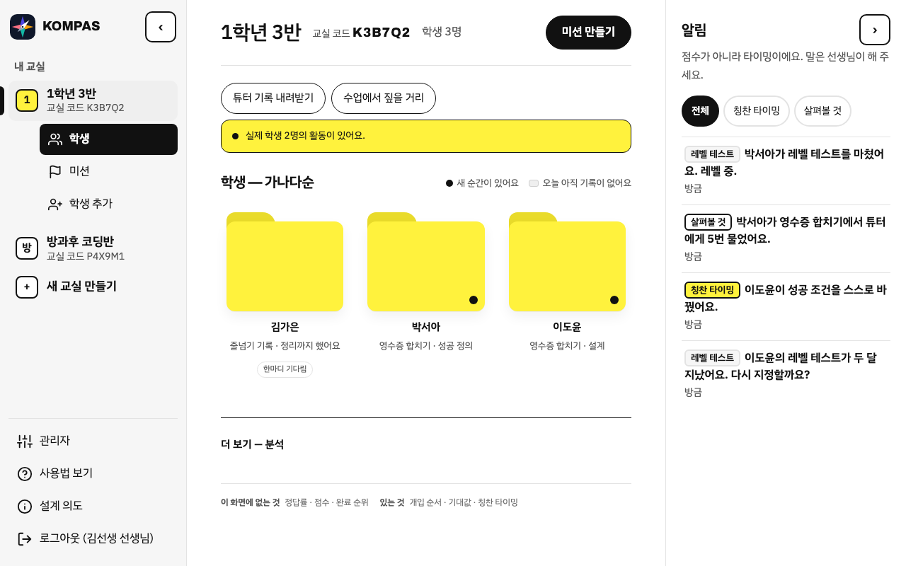
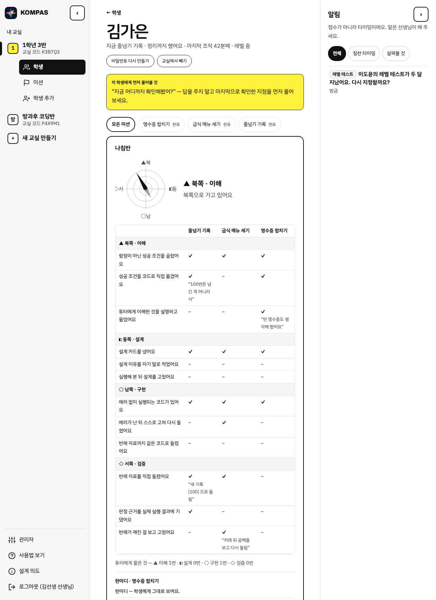
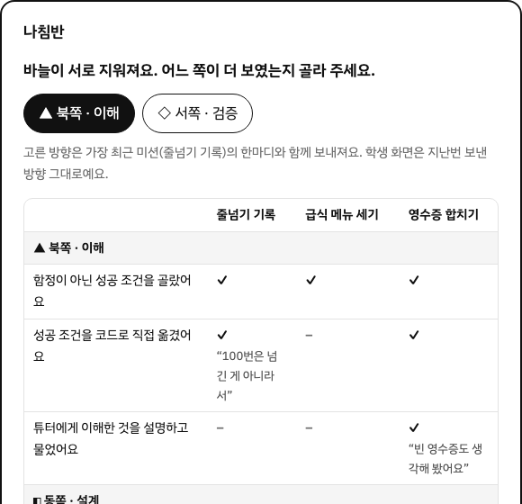
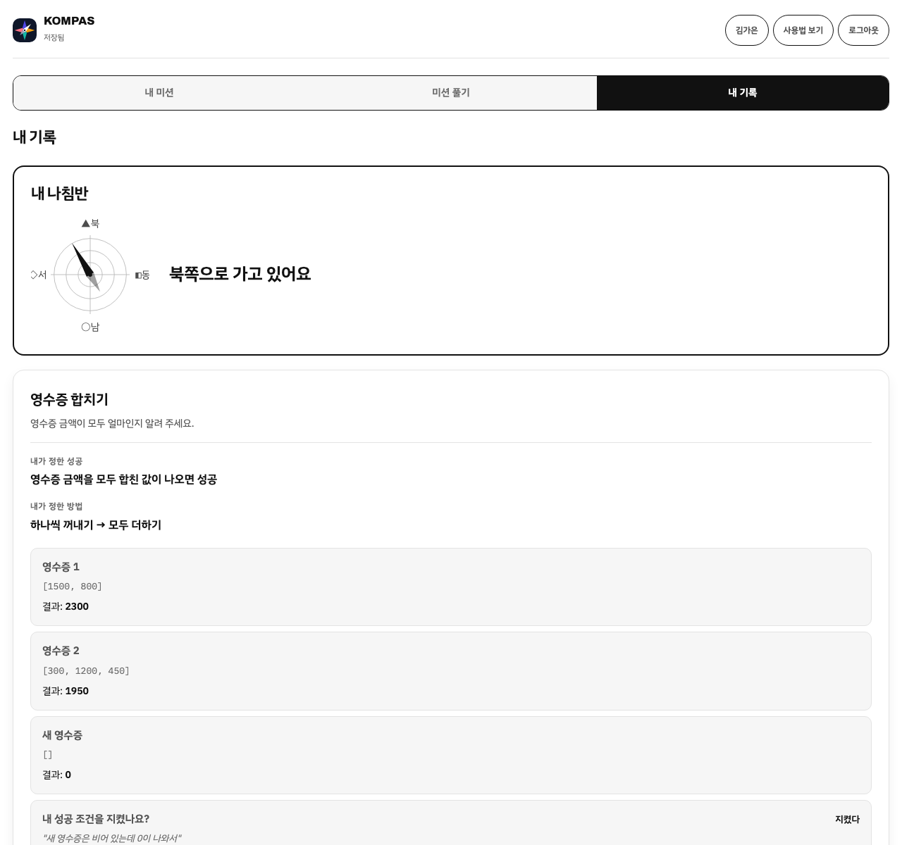

# KOMPAS

**의도를 코드로 옮긴다.** 목적지는 몰라도, 방향은 안다.

중학교 1~2학년이 모호한 요청을 받아 **성공을 정의하고 · 설계하고 · 코드로 옮기고 · 스스로 판정하는** 파이썬 수업 도구입니다.
(예전 이름: Cut & Check)

> **시작은 대신해주고, 판단은 하나도 대신하지 않는다.**

빈 편집기 앞에서 막히는 건 도와주고(모호한 문제 · 설계 카드 · 튜터의 문법 설명),
무엇이 성공인지 · 맞았는지 · 잘했는지는 기계가 정하지 않습니다. 학생이 판정하고, 칭찬은 강사가 씁니다.
기계가 하는 일은 **사실을 모아 타이밍을 알려 주는 것**까지입니다.

---

## 누가 무엇을 판단하나

| | 기계가 하는 것 | 사람이 하는 것 |
|---|---|---|
| 성공 조건 | 보기를 보여 준다(함정 섞음, 어느 게 맞는지 말하지 않음) | **학생**이 고르고, 언제든 다시 정한다 |
| 실행 결과 | 자료 3개로 돌려 결과를 나란히 보여 준다. 마지막 자료는 늘 반례 | **학생**이 "내 성공 조건을 지켰나" 판정한다 |
| 막혔을 때 | 튜터가 문법은 알려 주고(이름 · 생김새 · 미션과 상관없는 예시), 풀이는 되묻는다 | **학생**이 미션에 옮긴다 |
| 칭찬 | "지금이 칭찬 타이밍" 알림만 | **강사**가 한마디를 쓴다 |
| 학생의 방향(나침반) | 방향별 예/아니오 항목을 모아 바늘을 그린다 | 방향이 겹치면 **강사**가 고른다 |
| 레벨 | 레벨 테스트 답을 강사 화면에서만 계산한다 | **강사**가 반 분포를 보고 문제 난이도를 맞춘다 |

---

## 화면

강사 화면은 세 칸 — 왼쪽 접히는 사이드바(교실 · 학생 · 미션), 가운데 한 열 본문, 오른쪽 접히는 알림.
학생 화면은 위에 탭 셋(내 미션 · 미션 풀기 · 내 기록), 미션을 풀 때 오른쪽에 접히는 튜터.
**오른쪽은 강사에게는 알림, 학생에게는 튜터**만 둡니다. 휴대폰에서는 오른쪽 칸이 아래 노란 막대가 됩니다.

### 강사 — 교실과 알림



알림은 이름표 셋, 사실만 씁니다. 순서 번호 · 소요 시간 · 반 평균은 붙이지 않습니다.

- **칭찬 타이밍** — 미션을 마쳤어요 · 성공 조건을 스스로 바꿨어요 · 에러 뒤 스스로 고쳐 다시 돌렸어요 · 나침반 방향이 겹쳐요
- **살펴볼 것** — 하드코딩일 수 있어요 · 튜터에게 5번 물었어요 · 설계도를 냈어요
- **레벨 테스트** — 테스트를 마쳤어요 · 두 달이 지났어요

### 강사 — 학생 상세와 나침반



그 학생이 한 일을 시간순으로, 설계도와 코드를 나란히, 튜터에게 물은 것과 수업에서 짚을 거리를 봅니다.

**나침반**은 네 방향 — 북 이해 · 동 설계 · 남 구현 · 서 검증. 방향마다 예/아니오 3항목을 보고(예: "반례 자료를 직접 돌렸다"),
최근 5개 미션을 모아 바늘 하나로 그립니다. 항목과 근거 인용은 강사에게만 보입니다.
방향이 서로 지워지면 기계가 정하지 않고 강사가 고릅니다 — 마침 칭찬 타이밍입니다.



### 학생 — 코딩과 튜터


튜터 대화는 미션마다 하나이고, 나중에 다시 열어 볼 수 있습니다. 미션 자료에 바로 붙일 코드는 주지 않습니다.

### 학생 — 내 기록



학생에게는 바늘 · 방위 · 강사가 쓴 한마디만 갑니다. 점수 · 항목 · 레벨은 보이지 않습니다.

---

## 핵심 흐름

### 강사

```
가입 → 교실 만들기 → 학생 계정 만들기 → 미션 만들기 → 수업 중 알림 보기 → 학생 상세에서 한마디
```

1. **교실 만들기** — 가입은 강사만 합니다.
2. **학생 계정 만들기** — 이름 · 아이디를 적으면 비밀번호를 한 번 보여 줍니다.
   필요하면 **레벨 테스트를 지정**합니다 — 문제지 하 · 중 · 상 중 하나. 기록(날짜 · 맞힌 수 · 문항별)과 레벨은 강사에게만.
3. **미션 만들기** — 탭 둘.
   - **단계별로**: 수업 내용 → 개념 확인 → 이야기 고르기 → 문제 확인. AI 가 모범 답안을 쓰고 강사 브라우저에서 돌려 자료별 정답을 붙입니다. 강사가 확정해야 학생에게 보입니다.
   - **한 번에**: 수업 내용만 넣고 바로 초안.
   - 마지막 자료는 늘 반례 — 개수 변화 · 구분자 변화 · 빈 결과 · 앞뒤 공백 · 경계값 중 하나를 건드립니다.
   - 강사마다 생성 횟수가 정해져 있습니다(관리자가 늘려 줌).
4. **수업 중** — 오른쪽 알림을 보고, 누르면 그 학생 상세로 갑니다.
5. **한마디** — 미션을 마친 학생의 나침반을 보고 강사가 씁니다.

### 학생

```
로그인 → (레벨 테스트) → 미션 고르기 → 01 문제 → 02 성공 → 03 설계 → 04 코딩 → 05 정리
```

1. **로그인** — 강사가 만들어 준 아이디로. 지정된 학생은 레벨 테스트부터(맞았는지 · 난이도는 보이지 않습니다).
2. **01 문제** — 요청은 일부러 모호합니다. 방법은 어디에도 없습니다.
   > 창고에 주문서가 들어왔어요. 상품이 몇 개인지 알려주세요.
3. **02 성공** — 무엇이 성공인지 고르고 이유를 한 줄 씁니다. 보기에는 함정이 섞여 있습니다.
4. **03 설계** — 할 일 카드를 담고 순서를 맞춥니다(필요 없는 카드도 섞여 있습니다).
5. **04 코딩** — 설계도 옆에서 코드를 쓰고 자료 3개로 실행합니다. 막히면 오른쪽 튜터에게 묻습니다.
6. **05 정리** — 내 성공 조건을 지켰는지 판정하고, 처음과 달라진 점을 남깁니다.
7. 강사가 한마디를 보내면 **내 기록**에 내 나침반이, 그 미션을 다시 열면 선생님 한마디가 보입니다.

### 관리자

강사별 생성 횟수 보기 · 늘리기 · 끄기, 최근 생성 기록, 신규 가입 기본 횟수.

화면별 자세한 안내는 [docs/수업-흐름.md](docs/수업-흐름.md).

---

## 만들지 않는 것

| 만들지 않는 것 | 왜 |
|---|---|
| 정답과 대조하는 채점 · "틀렸어요" | 채점하는 순간 학생은 우리 답을 추측하러 간다 |
| 점수 · 순위 · 정답률 · 연속 출석 | 숫자를 띄우면 강사는 줄을 세우고 학생은 결과를 맞히러 간다 |
| 기계가 쓰는 칭찬 | 칭찬을 기계에 넘기면 사람의 격려가 싸구려가 된다 |
| 다음에 할 일 추천 · 실행 전 힌트 | 판단 대행의 가장 흔한 형태 |
| 학생 화면에 반 전체 현황 | 수업이 속도 경쟁이 된다 |
| 앞뒤 공백을 알아서 봐주는 비교 | 봐주면 학생은 그 개념을 평생 만나지 못한다 |

예외 둘 — **강사 화면에만**: 레벨(상 · 중 · 하)과 나침반의 항목 · 점수. 학생에게는 가지 않습니다.

약속은 코드가 지킵니다. 이벤트에 점수류 필드를 넣으면 저장 함수가 거절하고(`js/core/events.js`),
화면에 금지 단어가 뜨면 테스트가 깨지고(`test/smoke.js`), 학생이 쓴 글이 강사 화면에 글자 그대로 올라가는지 검사합니다(`test/robust.js`).

---

## 해보기

```bash
git clone https://github.com/tomchaccom/KOMPAS.git
cd KOMPAS
python3 -m http.server 8123
```

`localhost:8123` 을 열면 소개 페이지입니다. 서버 없이 열면 이 브라우저 안에서만 도는 **로컬 모드**,
로그인 · 교실 · 학생 계정 · AI(미션 생성 · 튜터 · 나침반)는 Vercel 함수 + Supabase 를 붙였을 때 동작합니다 — [docs/server.md](docs/server.md).
서버는 기록의 조건이 아니라 사본입니다. 와이파이가 끊겨도 학생이 누른 것은 사라지지 않습니다.

| 주소 | 화면 |
|---|---|
| `/auth.html` | 로그인 · 강사 가입 |
| `/sentence.html` | 학생 화면 |
| `/teacher.html` | 강사 화면 |
| `/admin.html` | 관리자 화면 |
| `/philosophy.html` | 설계 철학 한 장 |
| `/print.html` | 수업 준비물(인쇄용) |

---

## 구조

```
화면     landing · auth · sentence(학생) · teacher(강사) · admin · philosophy · print
js/core  판단의 규칙 — 이벤트 계약, 접기(fold), 실행 엔진, 알림 · 나침반 그림, 레벨 테스트, 조사 계산, AI 출력 검사
js/data  바깥 세계 — localStorage · Supabase · 오프라인 발신함
js/ui    화면 — DOM 만 만진다
api/     Vercel Python 함수 — 미션 생성, 튜터와 가드레일, 수업에서 짚을 거리, 나침반, 학생 계정, 생성 한도, 관리자
```

번들러 · ES 모듈 없이 정적 파일만 씁니다 — 강사가 파일을 열어 고칠 수 있어야 합니다.
층의 경계(core 는 저장소 · 화면을 모른다)는 `test/layer.test.js` 가 지킵니다.
테스트 목록과 작업 규칙은 [CLAUDE.md](CLAUDE.md).

---

## 문서

| | |
|---|---|
| [docs/수업-흐름.md](docs/수업-흐름.md) | 수업 흐름 안내 — 화면 기준, 강사용 |
| [docs/philosophy.md](docs/philosophy.md) | 설계 철학 전문 |
| [docs/server.md](docs/server.md) | 서버 · 배포 순서 |
| [docs/tech-spec.md](docs/tech-spec.md) | 테크스펙 |
| [docs/curriculum.md](docs/curriculum.md) · [docs/semester.md](docs/semester.md) · [docs/lesson.md](docs/lesson.md) | 미션 설계 원리 · 15차시 · 45분 지도안 |
| [docs/superpowers/specs/brand.md](docs/superpowers/specs/brand.md) | 이름 · 아이콘의 뜻 |
| [CLAUDE.md](CLAUDE.md) | 기여자용 작업 규칙 |
