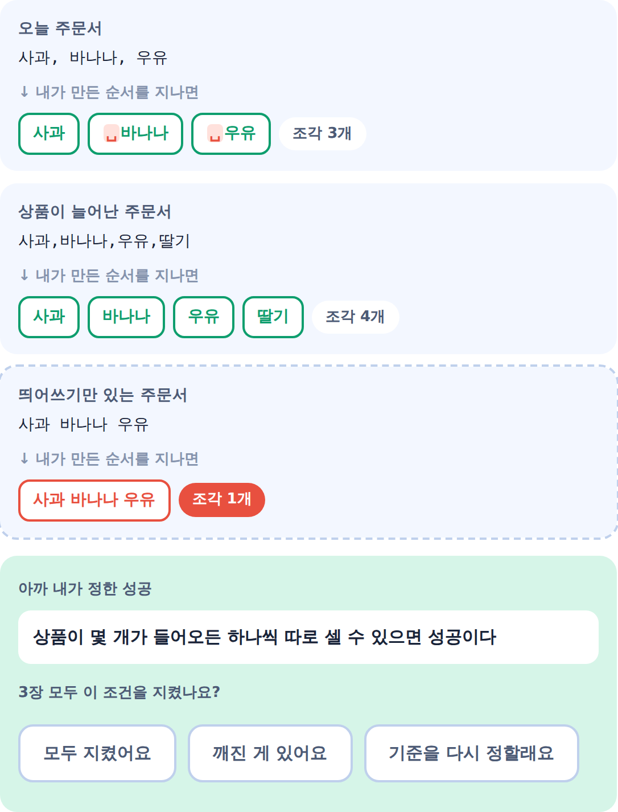
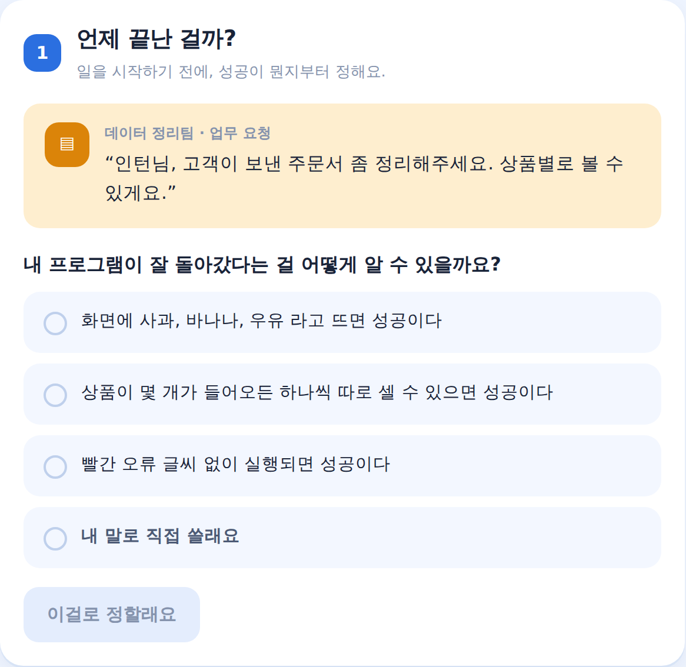
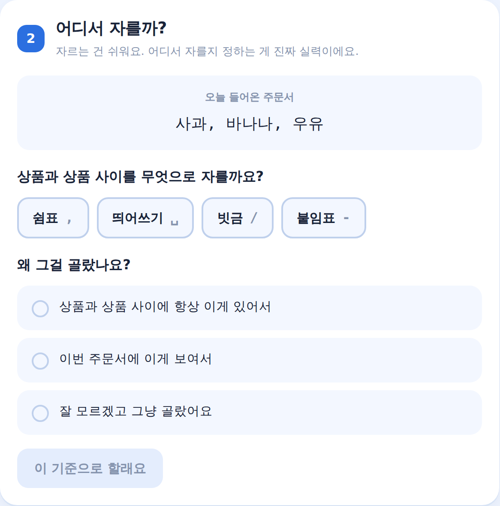
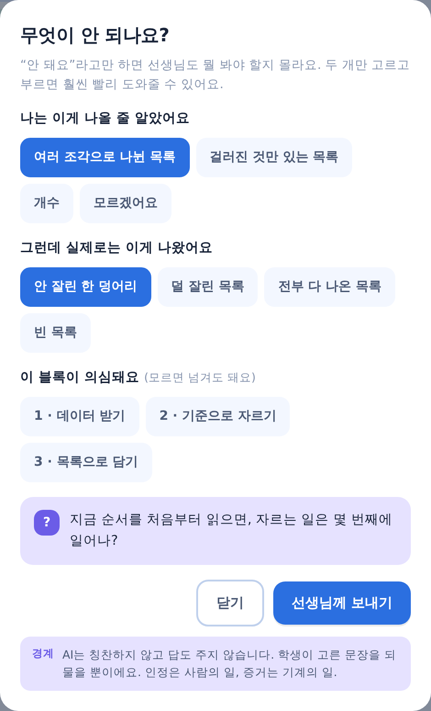
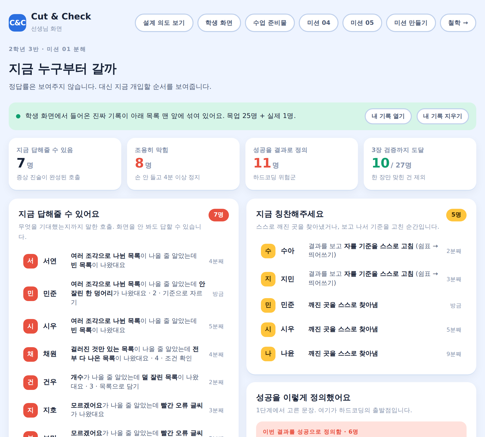
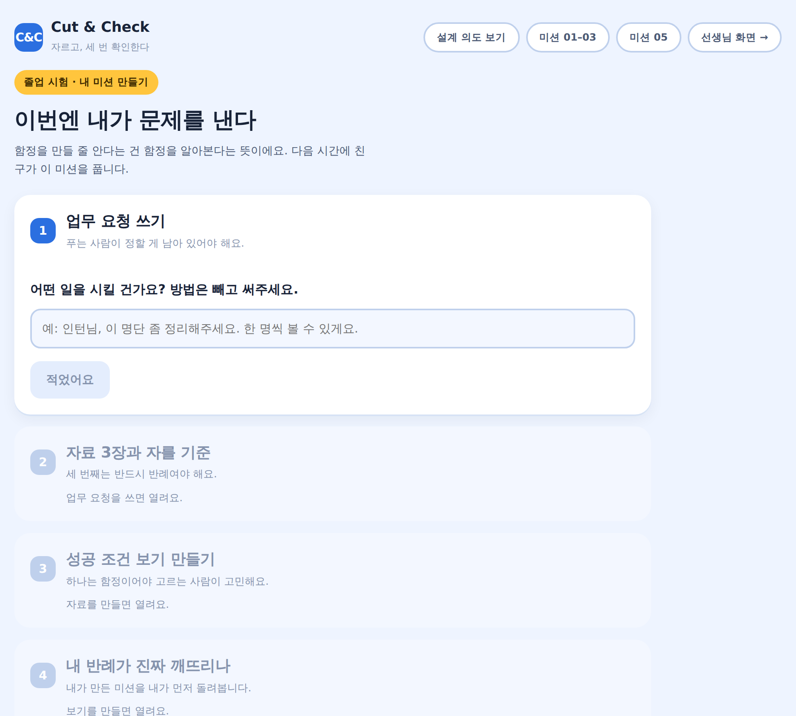

# Cut & Check

**자르고, 세 번 확인한다.**

중학교 1~2학년이 문제를 **정의하고 · 쪼개고 · 조립하고 · 스스로 깨뜨려보는** 수업 도구입니다.
파이썬 문법을 가르치지 않습니다. 문법은 3년 뒤에 바뀌고, 여기서 기르는 건 그 뒤에도 남는 것입니다.

브라우저만 있으면 돌아갑니다. 설치도 빌드도 서버도 없습니다.

---

## 30초 요약

학생이 **업무 요청**을 하나 받습니다. 방법은 어디에도 안 적혀 있습니다.

> 창고에서 주문서가 들어옵니다. 상품이 몇 개인지 알아야 해요.

학생이 직접 정합니다 — **무엇이 성공인가**, **무엇을 기준으로 자를 것인가**, **왜 그 기준인가**.
그리고 블록을 조립해서 자료 **세 장**에 돌려봅니다.
세 번째 장은 **반드시 학생의 기준을 깨뜨리도록** 설계돼 있습니다.

이 도구는 깨진 걸 보여주기만 하고, **"틀렸다"고 말하지 않습니다.**
판정은 학생이 합니다. 그리고 기준을 다시 정할 수 있습니다.



세 번째 자료에서 조각이 1개가 됐습니다.
화면은 여기서 "자르기 기준을 바꾸세요"라고 말하지 않습니다.
**"3장 모두 이 조건을 지켰나요?"** 라고만 묻습니다.

---

## 설계 철학 한 줄

> **시작은 대신해주고, 판단은 하나도 대신하지 않는다.**

이 한 줄이 이 저장소의 모든 결정을 설명합니다.

교실에서 벌어지는 두 가지 막막함은 종류가 다릅니다.

| | 무엇 | 우리의 대응 |
|---|---|---|
| **시작 지점의 막막함** | 빈 화면, 무엇부터 칠지 모름, 오타 하나로 멈춤 | **완전히 없앤다.** 블록으로 고르고, 예시 글자는 클릭해서 넣는다 |
| **판단의 막막함** | 무엇이 성공인지, 왜 그 기준인지, 왜 깨졌는지 | **하나도 건드리지 않는다.** 이게 배울 내용 전부다 |

대부분의 교육 도구는 이 둘을 구분하지 않습니다.
친절하게 만들다 보면 판단까지 대신해주고, 그 순간 학생이 할 일이 사라집니다.

자세한 논거: **[docs/philosophy.md](docs/philosophy.md)** · 브라우저로 보려면 [philosophy.html](philosophy.html)

---

## 그래서 화면에 어떻게 나타나는가

### 1. 방법이 적히지 않은 업무 요청



성공 조건 보기 안에는 **함정이 섞여 있습니다.**
"화면에 사과, 바나나, 우유 라고 뜨면 성공이다" — 이번 자료에만 맞는 문장(하드코딩)입니다.
어느 게 함정인지 화면은 **끝까지 알려주지 않습니다.** 세 번째 자료가 알려줍니다.

### 2. 기준보다 "왜 그 기준인가"



"그냥 골랐어요"도 고를 수 있습니다. 막지 않습니다.
막으면 학생은 그럴듯한 이유를 지어내는 법을 배웁니다. 그건 우리가 가르치려는 게 아닙니다.
대신 그 선택은 선생님 화면에 그대로 뜹니다.

### 3. "안 되는데요"를 디버깅 1단계로 바꾸기



도움 요청 버튼을 누르면 곧바로 선생님을 부르지 않습니다.
**무엇이 나올 줄 알았는지**와 **실제로 무엇이 나왔는지**를 고르게 합니다.

"안 돼요"라고만 말하는 건 게으름이 아니라 **어휘의 부재**입니다.
예측한 적이 없으면 "다르다"고 말할 수가 없습니다.
이 두 칸을 채우는 순간, 학생은 이미 디버깅의 절반을 한 것입니다.

### 4. 정답률 대신 개입 순서를 보여주는 선생님 화면



정답률도, 순위도, 소요 시간도 **띄우지 않습니다.** 저장조차 하지 않습니다.
숫자를 띄우면 선생님은 그 숫자로 줄을 세우고, 학생은 다시 결과를 맞히러 갑니다.

대신 이것만 보여줍니다.

- **지금 답해줄 수 있어요** — 증상 진술이 완성된 호출. 화면을 안 봐도 답할 수 있습니다
- **조용히 막힘** — 손을 안 드는 쪽이 더 위험합니다
- **지금 칭찬해주세요** — 스스로 깨진 곳을 찾아냈거나, 보고 나서 기준을 고친 순간
- **성공을 결과로 정의함** — 하드코딩 위험군. 개념 오류의 출발점입니다

> **칭찬은 타이밍만 알려주고, 말은 선생님이 합니다.**
> AI가 "좋아요!"를 남발하면 사람의 인정이 싸구려가 됩니다.
> 스탠퍼드 Code in Place가 수만 명 규모에서 사람 강사를 유지하는 이유가 이것입니다.

### 5. 졸업 시험 — 미션을 푸는 게 아니라 만든다



한 학기의 마지막 과제는 **학생이 미션을 만드는 것**입니다.
업무 요청을 모호하게 쓰고, 성공 조건 보기에 함정을 심고, **자기 미션을 깨뜨릴 반례를 설계**합니다.

함정을 만들 줄 안다는 건 함정을 알아본다는 뜻입니다.
반례를 설계할 줄 알면 명세화 능력을 얻은 것이고, 그게 이 과목의 목표 전부입니다.

---

## 만들지 않기로 한 것

이 목록이 만든 것보다 중요합니다. 전부 한 번씩 "좋은 아이디어"로 제안됐다가 거절된 것들입니다.

| 만들지 않은 것 | 왜 |
|---|---|
| 점수 · 포인트 · 연속 출석 · 레벨 | 칭찬을 기계에 넘기면 사람의 격려가 싸구려가 된다 |
| "좋아요!" 성공 팝업 | 같은 이유. 인정은 사람의 일이다 |
| 정답 블록 순서와 대조하는 채점 | 채점하는 순간 학생은 우리 답을 추측하기 시작한다 |
| 다음에 놓을 블록 추천 | 판단 대행의 가장 흔한 형태 |
| 실행 전에 열리는 힌트 · 코드 보기 | 증상을 말하기 전에 주면 말할 이유가 사라진다 |
| 앞뒤 공백을 알아서 봐주는 비교 | 봐주면 학생은 그 개념을 평생 만나지 못한다 |
| 교사 화면의 정답률 · 순위 | 숫자를 띄우면 교사가 줄을 세운다 |

이건 문서에만 적힌 약속이 아닙니다. **코드가 거절합니다.**

- `js/core/events.js` — `score`, `rank`, `correct` 같은 필드는 저장 함수가 예외를 던집니다
- `js/core/llmguard.js` — AI가 칭찬하거나, 원인을 짚거나, 고치는 법을 말하면 출력이 차단됩니다
- `test/smoke.js` — 화면에 "정답률" 같은 금지 단어가 뜨면 테스트가 깨집니다

문서에만 적어둔 금지는 반드시 무너집니다. 그래서 실행 가능한 형태로 옮겼습니다.

---

## 해보기

```bash
git clone https://github.com/tomchaccom/Cut-Check.git
cd Cut-Check
python3 -m http.server 8123
```

그리고 브라우저에서:

| 주소 | 화면 |
|---|---|
| `localhost:8123/index.html` | **학생 화면** — 미션 01·02·03·06 + 졸업 과제 |
| `localhost:8123/teacher.html` | **선생님 화면** — 지금 누구부터 갈까 |
| `localhost:8123/philosophy.html` | **철학 한 장** — 리뷰·심사용 |
| `localhost:8123/abstract.html` | 미션 04 · 추상화 |
| `localhost:8123/review.html` | 미션 05 · 동료 검토 |
| `localhost:8123/make.html` | 졸업 시험 · 내 미션 만들기 |
| `localhost:8123/print.html` | 수업 준비물 (인쇄용) |

학생 화면에서 미션을 하나 풀고 선생님 화면을 열면, **방금 한 게 목록 맨 앞에 섞여 있습니다.**

---

## 구조

세 층으로 나뉩니다. 서버를 붙일 때 다치지 않기 위한 경계입니다.

```
js/core/    판단의 규칙. 저장소도 네트워크도 화면도 모른다
  events.js     이벤트 계약. 저장하면 안 되는 필드를 여기서 막는다
  fold.js       이벤트 → 학생 한 명 (순수 함수). 서버가 그대로 포팅한다
  engine.js     블록 실행 엔진 + 파이썬 변환
  blocks.js     논리 블록 카탈로그 (10개, 한계선 12개)
  missions.js   미션 데이터
  hangul.js     조사 계산 (은/는, 이/가, 을/를)
  llmguard.js   AI 출력 검사기
  asks.js       AI 되묻기 문장

js/data/    바깥 세계. 여기만 localStorage 와 fetch 를 안다
  config.js     apiBase 가 비면 로컬, 있으면 서버
  api.js        local / http 어댑터
  store.js      오프라인 우선 기록 + 발신함

js/ui/      화면. DOM 만 만진다. 서버가 있는지 없는지 모른다
  app.js  teacher.js  abstract.js  review.js  make.js  classroom.js
```

**번들러를 쓰지 않습니다.** 선생님이 파일을 열어서 고칠 수 있어야 하기 때문입니다.
ES 모듈도 쓰지 않습니다 — `file://` 에서 CORS로 막히고, 교실에서 그건 치명적입니다.

### 서버를 붙이면

`config.js` 의 `apiBase` 한 줄이면 전환됩니다. 화면 코드는 하나도 안 바뀝니다.

```html
<script>window.CC_CONFIG = { apiBase: 'https://...', classroomCode: '3-2' }</script>
```

서버가 죽어도 수업은 끝까지 갑니다. 학교 와이파이는 끊기고,
끊긴 순간 학생이 누른 게 사라지면 그 수업은 거기서 끝나기 때문입니다.
**서버는 기록의 조건이 아니라 기록의 사본입니다.**

서버 설계: **[docs/server.md](docs/server.md)**

---

## 테스트

```bash
python3 -m http.server 8123 &

node test/engine.test.js     # 반례가 실제로 깨지는지, 에러가 몇 번 블록을 짚는지
node test/hangul.test.js     # 조사
node test/llmguard.test.js   # AI 출력 규칙 + 우리 문장이 그 규칙을 지키는지
node test/layer.test.js      # 계층 경계 + 이벤트 계약 + 접기
node test/smoke.js           # 7개 화면 × 3폭 × 2테마, JS 에러 / 가로 스크롤 / 금지 단어
node test/robust.js          # 학생 자유 입력이 선생님 화면까지 안전하게 흐르는지
```

여섯 개 다 통과해야 커밋합니다.

---

## 문서

| | |
|---|---|
| [docs/philosophy.md](docs/philosophy.md) | 설계 철학 전문 — **먼저 읽을 것** |
| [docs/curriculum.md](docs/curriculum.md) | 미션 설계 원리 |
| [docs/semester.md](docs/semester.md) | 한 학기 15차시 |
| [docs/lesson.md](docs/lesson.md) | 45분 지도안 — 교사가 **하지 말아야 할 말** 목록이 핵심 |
| [docs/server.md](docs/server.md) | 서버 설계 |
| [docs/llm.md](docs/llm.md) | AI를 어디에 쓰고 어디에 안 쓰는가 |
| [docs/survey.md](docs/survey.md) | 검증 설문 (H1–H5) |
| [docs/demo.md](docs/demo.md) | 3분 시연 대본 + 예상 반박 |
| [docs/risks.md](docs/risks.md) | **아직 못 푼 것 10가지** |
| [CLAUDE.md](CLAUDE.md) | 기여자용 작업 규칙 |

`docs/risks.md` 를 숨기지 않은 이유는, 안 푼 걸 안 푼 채로 적어두지 않으면
다음 사람이 같은 자리에서 같은 시간을 쓰기 때문입니다.
