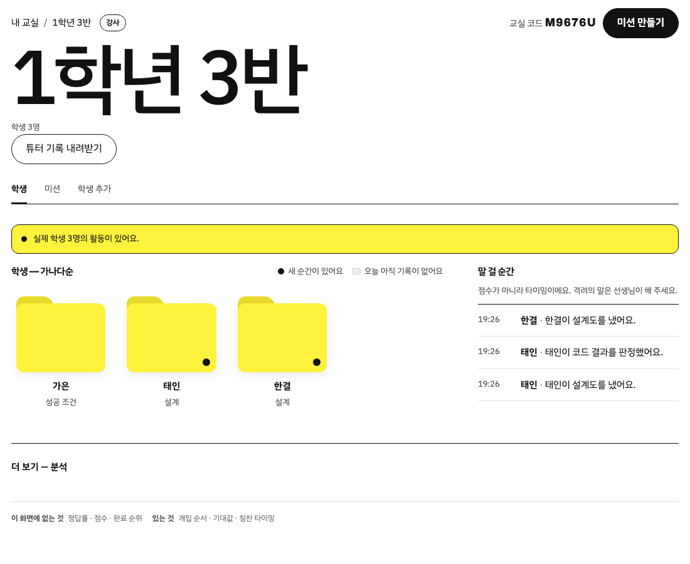
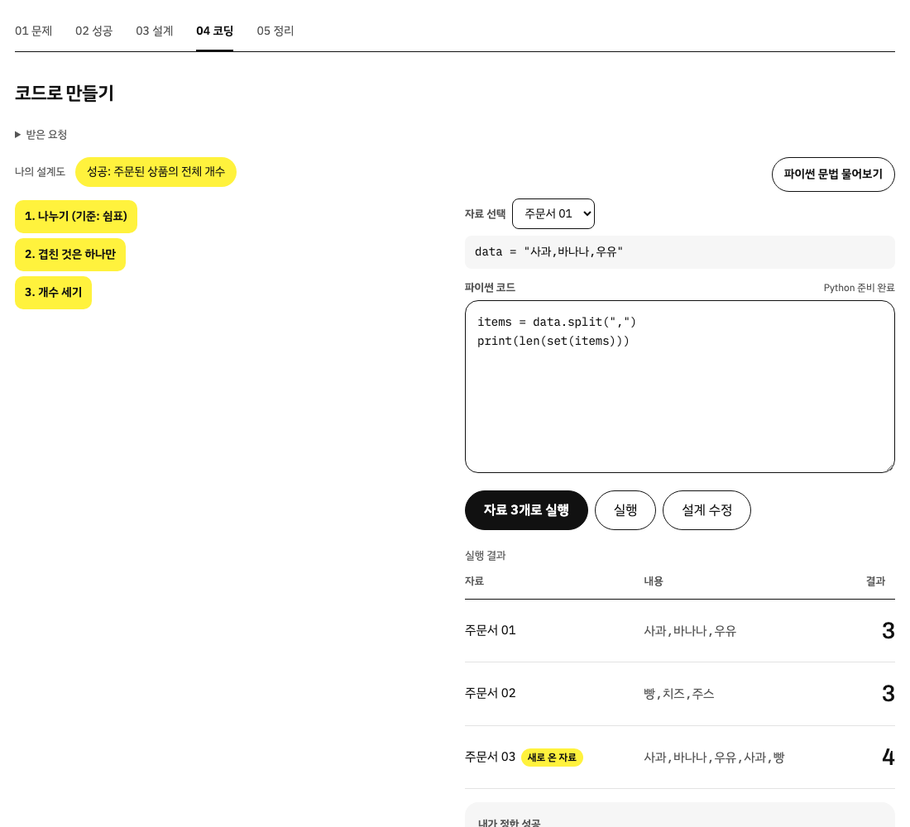
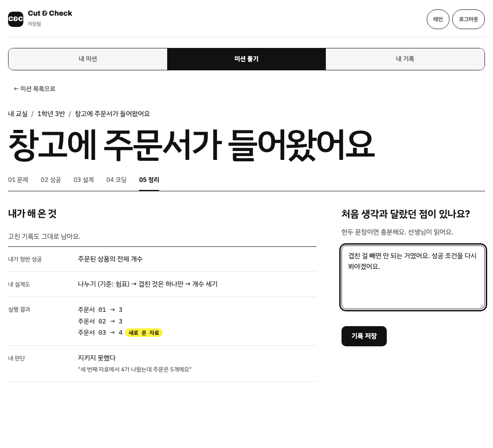

# Cut & Check

**자르고, 세 번 확인한다.**

중학교 1~2학년이 문제를 **정의하고 · 방법을 정하고 · 실행하고 · 스스로 판정하는** 수업 도구입니다.
파이썬 문법을 가르치지 않습니다. 문법은 3년 뒤에 바뀌고, 여기서 기르는 건 그 뒤에도 남는 것입니다.

브라우저만 있으면 돌아갑니다. 설치도 빌드도 서버도 없습니다.

---

## 핵심 흐름

전체 안내(화면마다 학생이 하는 일 · 화면이 하지 않는 일)는 [docs/수업-흐름.md](docs/수업-흐름.md) 에 있습니다.
화면은 가짜 교실(학생 3명)로 찍었습니다.

### 강사

| | |
|---|---|
|  |  |
| **교실 만들기** — 가입은 강사만 합니다 | **학생 계정 만들기** — 이름·아이디를 적으면 비밀번호와 함께 한 번 보여 줍니다 |
|  |  |
| **미션 확정** — AI 초안을 고쳐서 확정해야 학생에게 보입니다 | **학생 폴더** — 가나다순, 새로 생긴 일은 "말 걸 순간"에 사실만 |
|  | |
| **학생 서랍** — 한 학생이 한 것을 시간 순서대로, 튜터에게 물은 것까지 | |

### 학생

| | |
|---|---|
|  |  |
| **로그인** — 강사가 만들어 준 아이디로 | **레벨 테스트** — 10문항, 상·중·하는 강사에게만 |
|  |  |
| **내 교실** — 교실은 폴더 | **미션 목록** — 미션은 파일 |
|  |  |
| **01 문제** — 요청은 일부러 모호하게 | **02 성공** — 성공의 뜻을 스스로 고릅니다 |
|  |  |
| **03 설계** — 할 일 카드를 담고 순서를 맞춥니다 | **04 코딩** — 설계도 옆에서 코드를 쓰고 자료 3개로 실행 |
|  |  |
| **튜터** — 04 에서만, 문법만 답하고 풀이는 되묻습니다 | **05 정리** — 판정은 학생이, 돌아보는 문장은 선생님이 읽습니다 |

---

## 30초 요약

학생이 **업무 요청**을 하나 받습니다. 방법은 어디에도 안 적혀 있습니다.

> 창고에 주문서가 들어왔어요. 상품이 몇 개인지 알려주세요.

학생이 직접 정합니다:

1. **성공 조건** — "주문된 상품의 전체 개수" vs "서로 다른 상품 이름의 개수"
2. **설계** — 할 일 카드를 담고 순서를 맞춥니다 (필요 없는 카드도 섞여 있습니다)
3. **코드와 판정** — 설계도를 옆에 두고 파이썬 코드를 직접 쓰고, 자료 3개로 실행해 "내 성공 조건을 지켰는가" 판정
4. **정리** — 처음 생각과 달라진 점을 한두 문장으로

이 도구는 결과를 보여주기만 하고, **"틀렸다"고 말하지 않습니다.**
판정은 학생이 합니다. 기준을 다시 정할 수 있습니다.

---

## 해보기

```bash
git clone https://github.com/tomchaccom/Cut-Check.git
cd Cut-Check
python3 -m http.server 8123
```

브라우저에서 `localhost:8123` 을 열면 소개 페이지가 나옵니다. 서버 없이 열면 이 브라우저 안에서만 도는 로컬 모드입니다.
로그인·교실·학생 계정은 Supabase 를 붙였을 때만 동작합니다 (가입은 강사만, 학생 계정은 강사가 교실에서 만듭니다).

| 주소 | 화면 |
|---|---|
| `localhost:8123` | 소개 페이지 (`landing.html` 로 자동 이동) |
| `localhost:8123/auth.html` | 로그인 · 강사 가입 |
| `localhost:8123/sentence.html` | **학생 화면** — 내 교실 · 미션 01~05 |
| `localhost:8123/teacher.html` | **선생님 화면** — 학생 폴더 · 말 걸 순간 · 학생 추가 · 미션 |
| `localhost:8123/philosophy.html` | 철학 한 장 — 리뷰·심사용 |
| `localhost:8123/print.html` | 수업 준비물 (인쇄용) |

---

## 설계 철학 한 줄

> **시작은 대신해주고, 판단은 하나도 대신하지 않는다.**

| | 무엇 | 우리의 대응 |
|---|---|---|
| **시작 지점의 막막함** | 빈 화면, 무엇부터 칠지 모름 | **완전히 없앤다.** 할 일 카드와 코드 뼈대로 시작 비용 0 |
| **판단의 막막함** | 무엇이 성공인지, 왜 깨졌는지 | **하나도 건드리지 않는다.** 이게 배울 내용 전부다 |

## 만들지 않기로 한 것

| 만들지 않은 것 | 왜 |
|---|---|
| 점수 · 포인트 · 연속 출석 · 레벨 | 칭찬을 기계에 넘기면 사람의 격려가 싸구려가 된다 |
| "좋아요!" 성공 팝업 | 같은 이유. 인정은 사람의 일이다 |
| 정답 채점 | 채점하는 순간 학생은 우리 답을 추측하기 시작한다 |
| 다음 행동 추천 | 판단 대행의 가장 흔한 형태 |
| 교사 화면의 정답률 · 순위 | 숫자를 띄우면 교사가 줄을 세운다 |

이건 문서에만 적힌 약속이 아닙니다. **코드가 거절합니다.**

- `js/core/events.js` — `score`, `rank`, `correct` 같은 필드는 저장 함수가 예외를 던집니다
- `test/smoke.js` — 화면에 금지 단어가 뜨면 테스트가 깨집니다

---

## 구조

```
landing.html    소개 페이지
auth.html       로그인 · 강사 가입
sentence.html   학생 화면 (내 교실 · 미션 01~05)
teacher.html    선생님 화면
index.html      → landing.html 리다이렉트

js/core/    판단의 규칙. 저장소도 네트워크도 화면도 모른다
  events.js     이벤트 계약
  fold.js       이벤트 → 학생 한 명 (순수 함수)
  engine.js     블록 실행 + 문장형 실행(runSentence)
  missions.js   미션 데이터 (블록형 + 문장형)
  hangul.js     조사 계산
  llmguard.js   AI 출력 검사기
  asks.js       AI 되묻기 문장
  blocks.js     논리 블록 카탈로그

js/data/    바깥 세계. localStorage 와 fetch 를 안다
  config.js     apiBase 가 비면 로컬, 있으면 서버
  api.js        local / http 어댑터
  store.js      오프라인 우선 기록 + 발신함

js/ui/      화면. DOM 만 만진다
  sentence.js   문장형 미션 화면
  teacher.js    선생님 화면
  classroom.js  목업 교실 데이터
  app.js        블록형 미션 화면 (레거시)
  abstract.js   미션 04
  review.js     미션 05
  make.js       졸업 시험
```

**번들러를 쓰지 않습니다.** 정적 파일만 씁니다.

### 서버를 붙이면

`config.js` 의 `apiBase` 한 줄이면 전환됩니다.

```html
<script>window.CC_CONFIG = { apiBase: 'https://...', classroomCode: '3-2' }</script>
```

서버가 죽어도 수업은 끝까지 갑니다.
**서버는 기록의 조건이 아니라 기록의 사본입니다.**

---

## 테스트

```bash
python3 -m http.server 8123 &

node test/engine.test.js     # 블록+문장형 실행 검증
node test/hangul.test.js     # 조사
node test/llmguard.test.js   # AI 출력 규칙
node test/layer.test.js      # 계층 경계 + 이벤트 + 접기
node test/smoke.js           # 8개 화면 × 3폭 × 2테마
node test/robust.js          # 학생 자유 입력 안전 검사
```

---

## 문서

| | |
|---|---|
| [docs/수업-흐름.md](docs/수업-흐름.md) | **수업 흐름 안내** — 지금 화면 기준, 강사용 |
| [docs/tech-spec.md](docs/tech-spec.md) | **테크스펙** — 아키텍처, 데이터 모델, API, 요구사항 |
| [docs/user-flow.md](docs/user-flow.md) | **유저 플로우** — 학생·강사 전체 흐름 + 데이터 흐름 |
| [docs/philosophy.md](docs/philosophy.md) | 설계 철학 전문 |
| [docs/curriculum.md](docs/curriculum.md) | 미션 설계 원리 |
| [docs/semester.md](docs/semester.md) | 한 학기 15차시 |
| [docs/lesson.md](docs/lesson.md) | 45분 지도안 |
| [docs/server.md](docs/server.md) | 서버 설계 |
| [docs/risks.md](docs/risks.md) | 아직 못 푼 것 10가지 |
| [CLAUDE.md](CLAUDE.md) | 기여자용 작업 규칙 |
