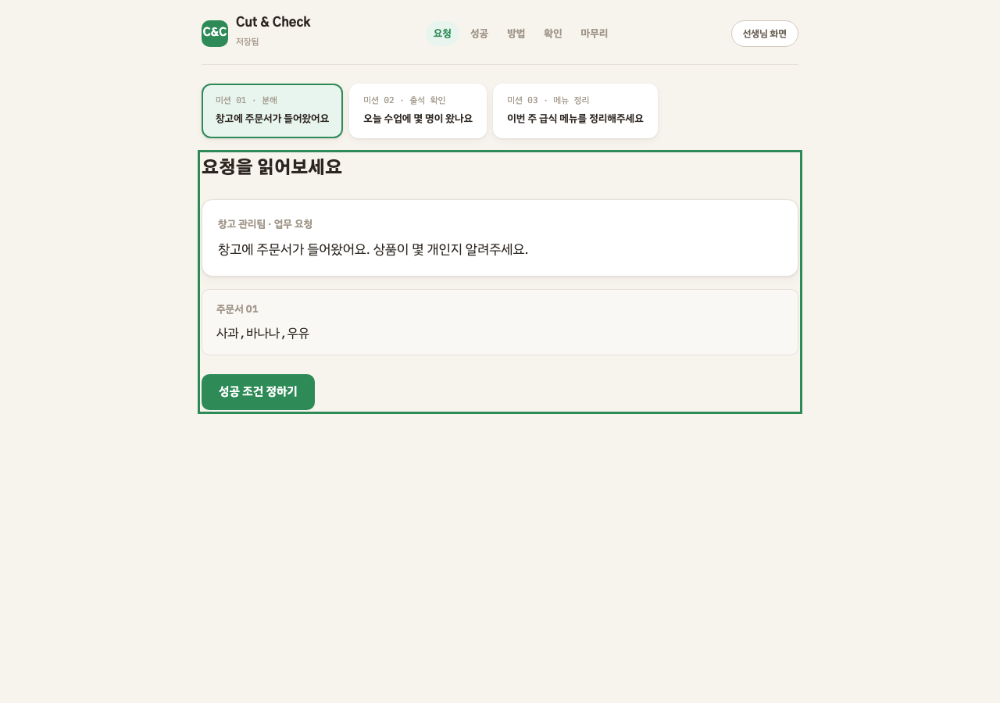
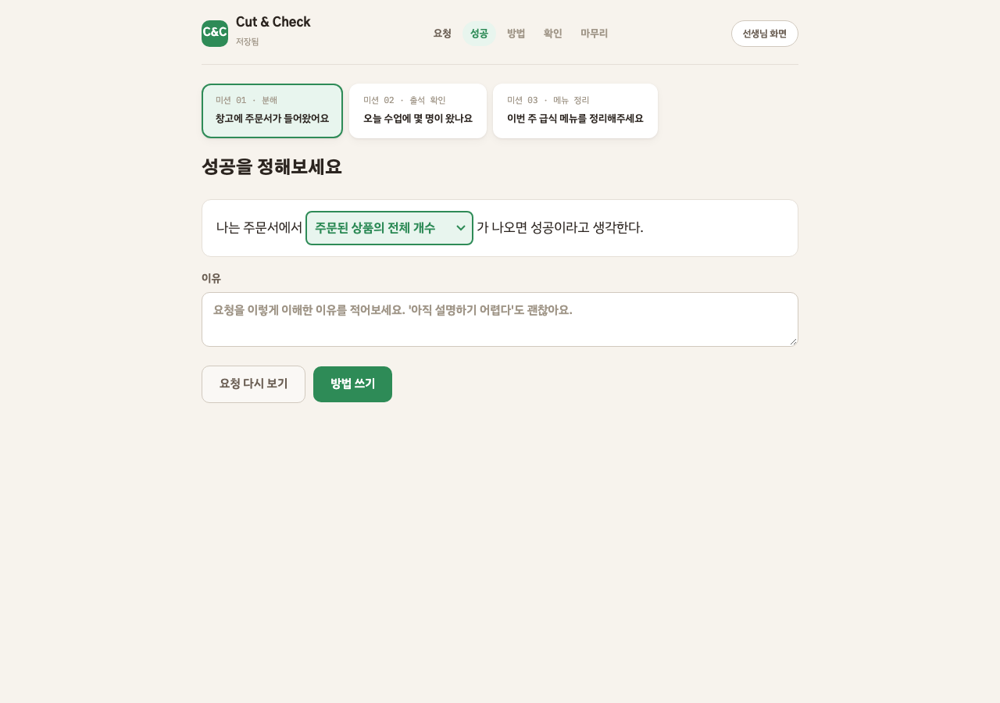
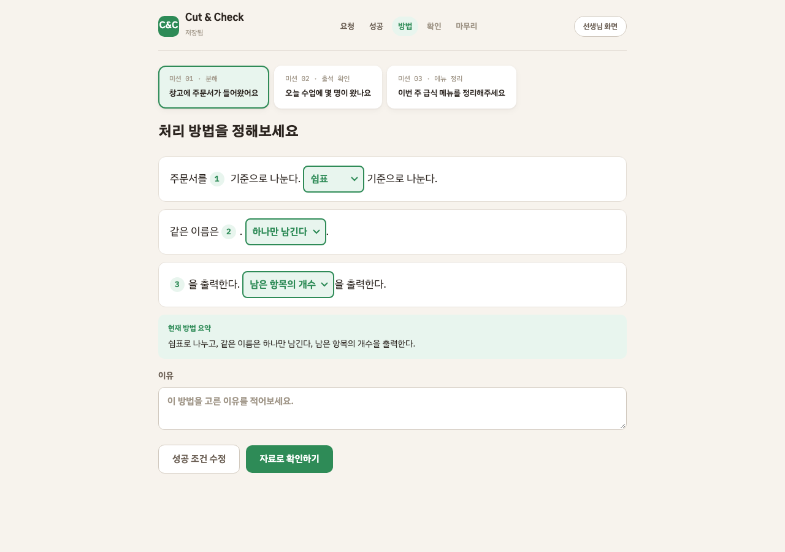
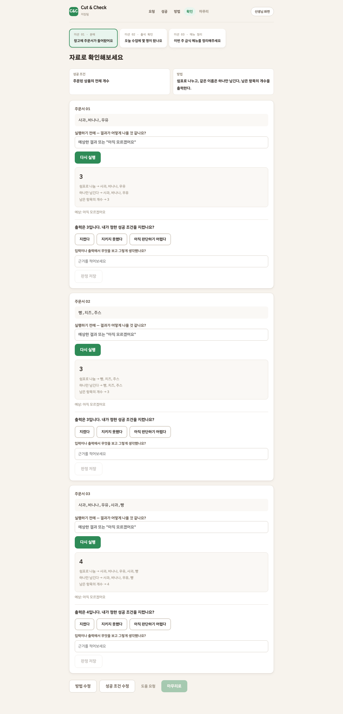
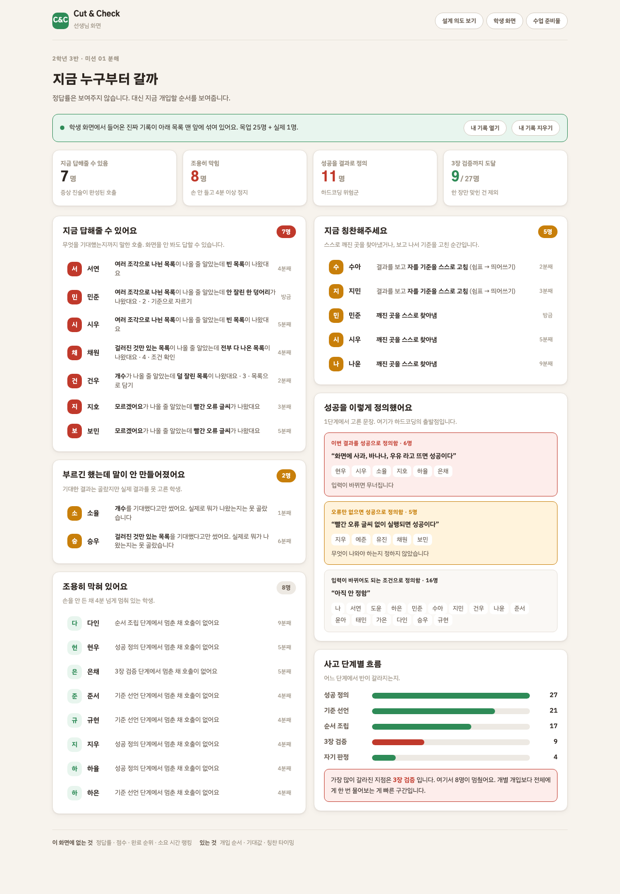

# Cut & Check

**자르고, 세 번 확인한다.**

중학교 1~2학년이 문제를 **정의하고 · 방법을 정하고 · 실행하고 · 스스로 판정하는** 수업 도구입니다.
파이썬 문법을 가르치지 않습니다. 문법은 3년 뒤에 바뀌고, 여기서 기르는 건 그 뒤에도 남는 것입니다.

브라우저만 있으면 돌아갑니다. 설치도 빌드도 서버도 없습니다.

---

## 30초 요약

학생이 **업무 요청**을 하나 받습니다. 방법은 어디에도 안 적혀 있습니다.

> 창고에 주문서가 들어왔어요. 상품이 몇 개인지 알려주세요.

학생이 직접 정합니다:

1. **성공 조건** — "주문된 상품의 전체 개수" vs "서로 다른 상품 이름의 개수"
2. **처리 방법** — 나누는 기준, 중복 처리, 출력 방식을 문장 빈칸으로 선택
3. **자료별 실행** — 3장의 자료를 실행하고, 각각 "내 성공 조건을 지켰는가" 판정
4. **마무리** — 처음 생각과 달라진 점을 돌아보기

이 도구는 결과를 보여주기만 하고, **"틀렸다"고 말하지 않습니다.**
판정은 학생이 합니다. 기준을 다시 정할 수 있습니다.

---

## 해보기

```bash
git clone https://github.com/tomchaccom/Cut-Check.git
cd Cut-Check
python3 -m http.server 8123
```

브라우저에서 `localhost:8123` 을 열면 바로 시작됩니다.

| 주소 | 화면 |
|---|---|
| `localhost:8123` | **학생 화면** — 문장형 미션 (자동 이동) |
| `localhost:8123/sentence.html` | 학생 화면 (직접 접근) |
| `localhost:8123/teacher.html` | **선생님 화면** — 지금 누구부터 갈까 |
| `localhost:8123/philosophy.html` | 철학 한 장 — 리뷰·심사용 |
| `localhost:8123/print.html` | 수업 준비물 (인쇄용) |

---

## 학생 사용 흐름

### 1단계: 요청 읽기



미션을 고르고 업무 요청을 읽습니다. 첫 자료가 함께 보입니다.

- 미션 01 · 주문서 — 상품이 몇 개인지
- 미션 02 · 출석부 — 학생이 몇 명인지
- 미션 03 · 급식 메뉴 — 메뉴가 몇 가지인지

### 2단계: 성공 정하기



> "나는 주문서에서 [주문된 상품의 전체 개수 / 서로 다른 상품 이름의 개수]가 나오면 성공이라고 생각한다."

빈칸을 선택하고 이유를 적습니다. 두 해석 중 어느 것이 정답인지 시스템이 알려주지 않습니다.

### 3단계: 방법 쓰기



세 줄의 문장에서 처리 방법을 선택합니다:

1. 주문서를 **[쉼표 / 공백 / 줄바꿈]** 기준으로 나눈다.
2. 같은 이름은 **[각각 남긴다 / 하나만 남긴다]**.
3. **[남은 항목의 개수 / 항상 숫자 3]**을 출력한다.

선택이 완료되면 방법 요약이 표시됩니다. "항상 숫자 3"은 하드코딩을 관찰하기 위한 의도적인 선택지입니다.

### 4단계: 자료별 실행·판정



자료 3장을 하나씩 실행합니다. 각 자료마다:

1. **예상** — 결과가 어떻게 나올지 적습니다 ("아직 모르겠어요"도 가능)
2. **실행** — 선택한 방법으로 실행하고 결과를 봅니다
3. **판정** — "지켰다 / 지키지 못했다 / 아직 판단하기 어렵다" 중 선택
4. **근거** — 무엇을 보고 그렇게 생각했는지 적습니다

세 번째 자료에는 중복이 포함되어 있어서, 방법에 따라 결과가 달라집니다.

| 방법 | 자료 01 | 자료 02 | 자료 03 |
|---|---|---|---|
| 쉼표 + 각각 남기기 + 개수 | 3 | 3 | **5** |
| 쉼표 + 하나만 남기기 + 개수 | 3 | 3 | **4** |
| 항상 숫자 3 | 3 | 3 | **3** |

방법을 수정할 수 있습니다. 이전 결과는 "이전 방법의 결과"로 표시됩니다.

### 5단계: 마무리

문장 틀을 채워서 오늘을 돌아봅니다:

> 처음에는 ___라고 생각했다.
> 자료 ___에서 ___를 보았다.
> 그래서 ___를 바꿨다 / 유지했다.
> 아직 확인하지 못한 것은 ___다.

---

## 강사 사용 흐름



`localhost:8123/teacher.html` 에서 학생들의 활동을 봅니다.

- 학생의 성공 조건, 방법, 최근 출력과 판정
- 도움 요청 여부와 시각
- 수정 전후 이력

정답률·순위·소요 시간은 **띄우지 않습니다.** 저장조차 하지 않습니다.

---

## 설계 철학 한 줄

> **시작은 대신해주고, 판단은 하나도 대신하지 않는다.**

| | 무엇 | 우리의 대응 |
|---|---|---|
| **시작 지점의 막막함** | 빈 화면, 무엇부터 칠지 모름 | **완전히 없앤다.** 선택형 빈칸으로 시작 비용 0 |
| **판단의 막막함** | 무엇이 성공인지, 왜 깨졌는지 | **하나도 건드리지 않는다.** 이게 배울 내용 전부다 |

## 만들지 않기로 한 것

| 만들지 않은 것 | 왜 |
|---|---|
| 점수 · 포인트 · 연속 출석 · 레벨 | 칭찬을 기계에 넘기면 사람의 격려가 싸구려가 된다 |
| "좋아요!" 성공 팝업 | 같은 이유. 인정은 사람의 일이다 |
| 정답 채점 | 채점하는 순간 학생은 우리 답을 추측하기 시작한다 |
| 다음 행동 추천 | 판단 대행의 가장 흔한 형태 |
| 교사 화면의 정답률 · 순위 | 숫자를 띄우면 교사가 줄을 세운다 |

이건 문서에만 적힌 약속이 아닙니다. **코드가 거절합니다.**

- `js/core/events.js` — `score`, `rank`, `correct` 같은 필드는 저장 함수가 예외를 던집니다
- `test/smoke.js` — 화면에 금지 단어가 뜨면 테스트가 깨집니다

---

## 구조

```
sentence.html   학생 화면 (문장형 미션, 주 진입점)
teacher.html    선생님 화면
index.html      → sentence.html 리다이렉트

js/core/    판단의 규칙. 저장소도 네트워크도 화면도 모른다
  events.js     이벤트 계약
  fold.js       이벤트 → 학생 한 명 (순수 함수)
  engine.js     블록 실행 + 문장형 실행(runSentence)
  missions.js   미션 데이터 (블록형 + 문장형)
  hangul.js     조사 계산
  llmguard.js   AI 출력 검사기
  asks.js       AI 되묻기 문장
  blocks.js     논리 블록 카탈로그

js/data/    바깥 세계. localStorage 와 fetch 를 안다
  config.js     apiBase 가 비면 로컬, 있으면 서버
  api.js        local / http 어댑터
  store.js      오프라인 우선 기록 + 발신함

js/ui/      화면. DOM 만 만진다
  sentence.js   문장형 미션 화면
  teacher.js    선생님 화면
  classroom.js  목업 교실 데이터
  app.js        블록형 미션 화면 (레거시)
  abstract.js   미션 04
  review.js     미션 05
  make.js       졸업 시험
```

**번들러를 쓰지 않습니다.** 정적 파일만 씁니다.

### 서버를 붙이면

`config.js` 의 `apiBase` 한 줄이면 전환됩니다.

```html
<script>window.CC_CONFIG = { apiBase: 'https://...', classroomCode: '3-2' }</script>
```

서버가 죽어도 수업은 끝까지 갑니다.
**서버는 기록의 조건이 아니라 기록의 사본입니다.**

---

## 테스트

```bash
python3 -m http.server 8123 &

node test/engine.test.js     # 블록+문장형 실행 검증
node test/hangul.test.js     # 조사
node test/llmguard.test.js   # AI 출력 규칙
node test/layer.test.js      # 계층 경계 + 이벤트 + 접기
node test/smoke.js           # 8개 화면 × 3폭 × 2테마
node test/robust.js          # 학생 자유 입력 안전 검사
```

---

## 문서

| | |
|---|---|
| [docs/tech-spec.md](docs/tech-spec.md) | **테크스펙** — 아키텍처, 데이터 모델, API, 요구사항 |
| [docs/user-flow.md](docs/user-flow.md) | **유저 플로우** — 학생·강사 전체 흐름 + 데이터 흐름 |
| [docs/philosophy.md](docs/philosophy.md) | 설계 철학 전문 |
| [docs/curriculum.md](docs/curriculum.md) | 미션 설계 원리 |
| [docs/semester.md](docs/semester.md) | 한 학기 15차시 |
| [docs/lesson.md](docs/lesson.md) | 45분 지도안 |
| [docs/server.md](docs/server.md) | 서버 설계 |
| [docs/risks.md](docs/risks.md) | 아직 못 푼 것 10가지 |
| [CLAUDE.md](CLAUDE.md) | 기여자용 작업 규칙 |
