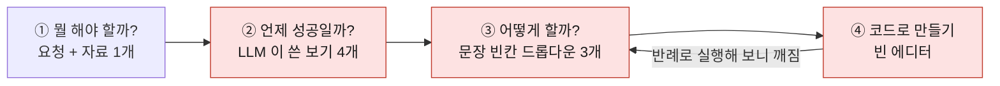
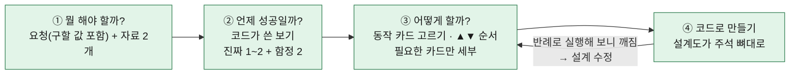
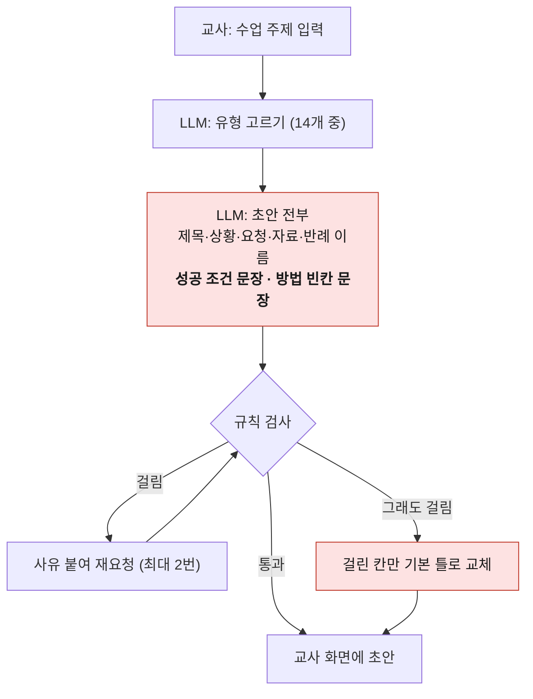
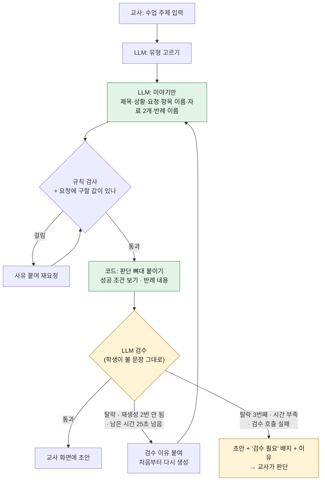

# 설계 카드 · 코드 뼈대 · 생성 검수 — 설계

날짜 2026-10-16 · 브랜치 `tomchaccom/card-design`

## 한눈에

| | 기존 | 바뀐 뒤 |
|---|---|---|
| 문제 화면 | 요청 + 자료 1개. "수를 세어 보세요" — 무슨 수인지 없음 | 요청 + 자료 2개. **구할 값을 생활 말로** ("몇 가지인지") |
| 성공 조건 보기 | LLM 이 씀 → "하나로 정한 기준이 맞으면 성공" 같은 모호한 문장 | **코드가 씀** → "겹치는 재료는 한 번만 센 수가 나오면 성공" |
| 설계(어떻게 할까?) | 문장 빈칸 드롭다운 → 빈칸 시험지 | **동작 카드 골라 순서 정하기** + 필요한 카드만 세부 |
| 코드 단계 | 빈 에디터 | **내 설계도가 주석 뼈대로** 들어가 있음 |
| 생성 품질 확인 | 규칙 검사기만 | 규칙 검사기 + **LLM 검수 → 재생성 2번 → 교사 검수** |

---

## 1. 학생 흐름

### 기존



문제점 (빨간 칸)
- ② 보기 뜻을 어른도 모른다. 함정 "3이 나오면 성공" 만 구체적이라 오히려 눌리기 쉽다.
- ③ "같은 목록은 [선택하기].", "[항상 숫자 3]만 보여준다." — 보기가 답지처럼 보인다.
  게다가 여기서 고른 값은 **실행되지 않는다** (`renderRunStep` 을 부르는 곳이 없다). 요약과 교사 기록에만 쓰인다.
- ④ 무엇부터 써야 할지 길잡이가 없다.

### 바뀐 뒤



### ③ 설계 화면 예시

```
내 설계도                          고를 수 있는 카드
┌────────────────────────────┐    [ 겹친 것은 하나만 ]
│ 1. 나누기  기준: [쉼표 ▾]  ▲▼✕│    [ 개수 세기 ]
│ 2. 겹친 것은 하나만        ▲▼✕│    [ 순서대로 늘어놓기 ]  ← 헷갈리는 카드
└────────────────────────────┘
```

### ④ 코드 에디터에 처음 들어가는 것

```python
# data 에 자료가 들어 있어요.
# 1. 나누기 (기준: 쉼표)

# 2. 겹친 것은 하나만

# 3. 개수 세기

```

- 함수 이름(split · set · len)은 보여주지 않는다 — 모르면 튜터에게 묻는다.
- 학생이 코드를 쓴 뒤 설계를 고치면 **덮어쓰지 않는다** (에디터가 비었거나 이전 뼈대 그대로일 때만 새로 넣음).

---

## 2. 미션 생성 흐름 (서버 `api/generate-mission`)

### 기존



- 기본 틀로 바뀌는 칸이 거의 다 **방법 문장**과 **성공 조건** — LLM 이 잘 못 쓰는 칸을 LLM 에게 시키고 있었다.
- 학생이 실제로 이해할 수 있는지는 아무도 확인하지 않는다.

### 바뀐 뒤



설계 카드는 서버가 만들지 않는다. 미션의 `pipelineId` 를 보고 학생 화면이 `js/core/cards.js` 에서 꺼낸다.

### 누가 무엇을 쓰나

| 칸 | 기존 | 바뀐 뒤 |
|---|---|---|
| 제목 · 상황 · 요청 · 항목 이름 · 자료 2개 · 반례 이름 | LLM | LLM (요청에 구할 값 규칙 추가) |
| 성공 조건 보기 | LLM (실패 시 코드 틀) | **코드** — `CORRECT[key]` 에 항목 이름만 끼움 |
| 방법 | LLM 빈칸 문장 (실패 시 코드 틀) | **코드** — 카드 카탈로그 |
| 반례 내용 | 코드 (PR #31) | 코드 |
| 검수 | 없음 | **LLM** (항목 4개) |

### LLM 검수 항목

| 항목 | 묻는 것 |
|---|---|
| `understand` | 중1이 요청을 읽고 무엇을 구해야 하는지 아는가 |
| `sameStory` | 세 자료가 같은 이야기인가 (과일·문구가 섞이지 않았나) |
| `noAnswer` | 문제 문장에 답이나 방법이 드러나지 않았나 |
| `easy` | 쉬운 말로 짧게 썼나 |

각 항목 `{ok, why}`. 하나라도 `ok: false` 면 탈락. 검수 문장은 교사만 본다.

---

## 3. 카드 카탈로그 (`js/core/cards.js`)

연산 하나 = 카드 하나 ≈ 코드 한 줄.

| 연산 | 카드 | 세부 |
|---|---|---|
| split | 나누기 | 기준: 쉼표 / 공백 / 줄바꿈 |
| filter | 골라내기 | {걸러낼 대상 이름}에: 있는 것만 / 없는 것만 |
| filter (숫자 유형) | 글자 빼기 | — |
| toNumber | 숫자로 바꾸기 | — |
| transform | 항목마다 다듬기 | 앞뒤 공백 없애기 / 첫 글자만 남기기 |
| unique | 겹친 것은 하나만 | — |
| sort | 순서대로 늘어놓기 | 가나다순 / 거꾸로 |
| join | 다시 이어 붙이기 | 이을 때: 쉼표 / 공백 |
| count | 개수 세기 | — |
| sum / max / min | 모두 더하기 / 가장 큰 값 찾기 / 가장 작은 값 찾기 | — |
| groupCount | 항목마다 몇 번인지 세기 | — |

- **헷갈리는 카드 1장** — 그 유형에 없는 연산을 고정 표로 고른다 (무작위면 교사와 학생 화면이 달라진다).
- **세부에 대놓고 틀린 보기("항상 숫자 3")를 넣지 않는다.**
- **채점하지 않는다.** 카드 순서를 정답과 대조하지 않는다 (CLAUDE.md 금지 목록). 틀린 설계는 반례 실행에서 학생이 발견한다.

---

## 4. 바뀌는 파일

| 파일 | 변경 |
|---|---|
| `js/core/cards.js` (새) | 카드 카탈로그 · 헷갈리는 카드 표 · 코드 뼈대 문자열 만들기 (순수 함수) |
| `sentence.html` · `js/ui/sentence.js` · `sentence.css` | ① 자료 2개, ③ 카드 화면, ④ 뼈대 넣기. 빈칸 문장 UI · `renderRunStep` 삭제 |
| `js/core/missions.js` | 기본 미션 sm1·sm2·sm3 에 `pipelineId` (sm-filter-1 은 이미 있음) |
| `js/core/events.js` · `fold.js` | `s-design` 에 `cards: [{op, label, detail}]` 추가 (label 을 같이 담아 교사 화면이 미션 없이도 읽는다) (`slots` 는 예전 기록용으로 유지, 스키마 버전 그대로) |
| `js/ui/teacher.js` | 설계도를 카드로 표시, 초안에 "검수 필요" 배지 |
| `api/_schema.py` · `api/_generate.py` | LLM 칸에서 성공 조건·방법 문장 제거, 요청 "구할 값" 규칙, 성공 조건은 코드로, 전체 시간 기준 |
| `api/_review.py` (새) | LLM 검수 |

## 5. 테스트 · 평가

- 카드: 14개 유형 모두 카드가 나오고, 헷갈리는 카드는 그 유형에 없는 연산, 세부 문구는 `llmguard` 통과.
- 생성: 성공 조건 보기 14개 유형 · "구할 값" 규칙 · 검수 흐름 5가지
  (통과 / 1번 탈락 후 통과 / 3번 탈락 → 교사 / 검수 호출 실패 → 교사 / 시간 부족 → 재생성 없음). 가짜 LLM 으로.
- E2E: 카드 고르기 → 순서 바꾸기 → 뼈대 확인, 코드 쓴 뒤 설계 수정 시 덮어쓰지 않음.
- robust: 카드 세부·이유가 교사 화면까지.
- eval: 검수 1차 통과율 · 재생성 횟수 · 교사 검수 비율.

## 범위 밖

튜터 거절 규칙(나중에), 블록형 화면(`index.html`), 디자인 변경, 카드 끌어 놓기.
