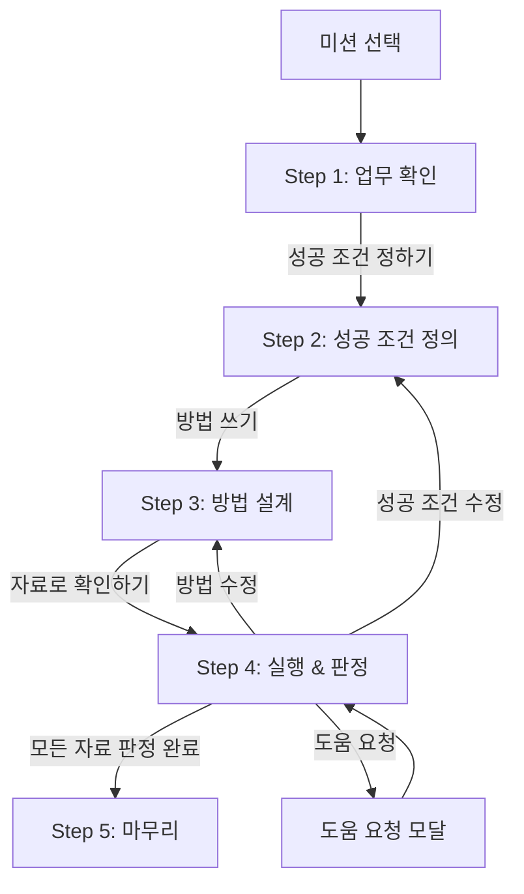

# Cut & Check — 유저 플로우

> 이 문서는 **문장형 미션(sentence.js)** 기준 학생 플로우,
> 교사 화면(teacher.js), 그리고 양쪽을 잇는 데이터 흐름을 정리한다.

---

## 1. 학생 플로우

### 1-1. 전체 흐름



### 1-2. 각 단계 상세

#### Step 1 — 업무 확인

| 항목 | 내용 |
|------|------|
| 화면 | `#step1` |
| 보이는 것 | `M.brief` (업무 요청문), `M.inputs[0]` (샘플 데이터) |
| 사용자 행동 | 읽고 "성공 조건 정하기" 클릭 |
| 저장 이벤트 | 없음 |
| 전환 조건 | `#go-define` 클릭 → `showStep(2)` |

#### Step 2 — 성공 조건 정의

| 항목 | 내용 |
|------|------|
| 화면 | `#step2` |
| 보이는 것 | 문장 빈칸: "나는 주문서에서 [___]가 나오면 성공이라고 생각한다." |
| 사용자 행동 | 성공 조건 선택 + 이유 입력(선택) + "방법 쓰기" |
| 저장 이벤트 | 첫 진입: `s-define { choice, reason }` / 재진입: `s-redefine { from, to, reason }` |
| 전환 조건 | `state.defineChoice` 비어있지 않아야 버튼 활성 |
| 상태 변화 | `state.defineVer++` |

#### Step 3 — 방법 설계

| 항목 | 내용 |
|------|------|
| 화면 | `#step3` |
| 보이는 것 | 3개 문장 프레임 (sep, dedup, output 슬롯). 모두 채우면 요약 문장 표시 |
| 사용자 행동 | 3개 슬롯 선택 + 이유 입력(선택) + "자료로 확인하기" |
| 저장 이벤트 | 첫 확정: `s-method { slots, reason }` / 재확정: `s-remethod { fromSlots, toSlots, reason }` |
| 전환 조건 | 3슬롯 모두 채워야 활성 |
| 상태 변화 | `state.methodVer++` |

#### Step 4 — 실행 & 판정

| 항목 | 내용 |
|------|------|
| 화면 | `#step4` |
| 보이는 것 | 현재 성공 조건 + 방법 요약. `M.inputs` 각각을 카드로 렌더링 |

**자료 1건의 실행-판정 사이클:**

```
예상 입력 ("결과가 어떻게 나올 것 같나요?")
    ↓  "실행" 버튼
    ├→ s-predict { dataId, predicted }
    ├→ engine.runSentence(slots, input)
    ├→ s-run { dataId, slots, result }
    ↓  결과 표시 (값 + 단계별 과정)
    ↓  판정: "지켰다" / "지키지 못했다" / "아직 판단하기 어렵다"
    ├→ 근거 입력
    ├→ "판정 저장"
    └→ s-judge { runId, verdict, basis }
```

| 전환 조건 | 설명 |
|-----------|------|
| "마무리" 활성 | `allDataJudged()` = 모든 자료에 대해 현재 `methodVer` 기준 최신 run + judge 존재 |

#### Step 5 — 마무리

| 항목 | 내용 |
|------|------|
| 화면 | `#step5` |
| 보이는 것 | 실행 이력 요약 + 빈칸 문장 5개 |
| 사용자 행동 | 빈칸 채우기 → "수업 기록 마무리" |
| 저장 이벤트 | `s-wrap { text }` |
| 완료 표시 | 버튼 → "저장됨" + 완료 메시지 |

빈칸 문장 조합:
> 처음에는 ___라고 생각했다. 자료 ___에서 ___를 보았다.
> 그래서 ___. 아직 확인하지 못한 것은 ___다.

### 1-3. 수정 루프

```
[Step 4] ──"방법 수정"──→ [Step 3] ──"자료로 확인하기"──→ [Step 4]
                                                          (methodVer 증가)

[Step 4] ──"성공 조건 수정"──→ [Step 2] ──→ [Step 3] ──→ [Step 4]
                                                          (defineVer 증가)
```

**핵심 규칙:**
- 방법을 바꾸면 `methodVer`가 올라간다. 마무리 활성 조건은 **현재 methodVer** 기준이므로, 방법 수정 후 모든 자료를 다시 실행·판정해야 한다.
- 이전 방법의 실행 결과는 "이전 방법의 결과" 배너로 표시되지만 새 방법 판정에 포함되지 않는다.
- 실행 전 예상과 당시 기준·방법은 실행 이후 수정으로 소급 변경되지 않는다 (append-only).

### 1-4. 도움 요청 흐름

```
"도움 요청" 버튼 → #help-dialog 모달
    ↓
    사용자 입력: 기대한 결과 + 막힌 곳
    ↓
    "보내기" → s-help { expected, stuck }
    ↓
    모달 닫힘, 입력 초기화
```

---

## 2. 강사 플로우

### 2-1. 대시보드 구성

#### 요약 타일

| 타일 | 의미 | 강조 |
|------|------|------|
| 지금 답해줄 수 있음 | 증상 진술 완성된 호출 수 | — |
| 조용히 막힘 | 4분 이상 무동작, 호출 없음 | alarm |
| 성공을 결과로 정의 | hardcode 위험군 | alarm |
| 3장 검증까지 도달 | stage ≥ 3 인 수 | good |

#### 명단 섹션

| 섹션 | 대상 | 한 줄 설명 |
|------|------|-----------|
| 지금 답해줄 수 있어요 | 증상 진술 완성 | "X가 나올 줄 알았는데 Y가 나왔대요" |
| 말이 안 만들어졌어요 | 기대만 작성 | "X를 기대했다고만 썼어요" |
| 조용히 막혀 있어요 | 4분+ 무동작 | — |
| 지금 칭찬해주세요 | 기준 수정 / 스스로 발견 | — |

#### 학생 상세

명단 클릭 → 하단 시트. 표시 항목: 성공 조건, 방법, 블록 순서, 증상, 수정 횟수, 문장형 데이터(성공/방법/실행/판정/도움/마무리). 맨 아래 "이 학생에게 먼저 물어볼 것" — 시스템이 질문을 하나 고른다.

### 2-2. 개입 의사결정

```
교사 화면 진입
    ↓
    타일 확인 → 0이 아닌 것부터
    ├─ [조용히 막힘] → 명단 → 상세 → "지금 어디까지 확인해봤어?"
    ├─ [답해줄 수 있음] → 명단 → 상세 → 증상 확인
    ├─ [위험군] → hardcode/luck 학생 → 문제 정의 질문
    └─ [칭찬 타이밍] → 스스로 고친 학생 → "지금 한마디 해주세요"
```

---

## 3. 데이터 흐름

### 3-1. 학생 → localStorage → 강사

```
sentence.js rec(type, payload)
    → CC.events.make(type, payload)   // 알 수 없는 type이면 throw
    → CC.store.push(ev)
        → localStorage['cutcheck.log.v1']   (append, 최대 200건)
        → localStorage['cutcheck.outbox.v1'] (서버 설정 시)
            → CC.api.send(batch) → 서버

teacher.js
    → CC.store.fold('나')
    → CC.fold.fold(evs, {id, name})
    → 학생 객체 반환 → 대시보드 렌더링
```

### 3-2. 이벤트 append-only

이벤트는 덧붙이기만 하고 수정·삭제하지 않는다. 학생이 기준을 고쳤다는 사실 자체가 가장 값진 기록이다.

### 3-3. 이벤트 타입 전체 목록 (문장형)

| 상수 | 문자열 | 발생 시점 | 주요 필드 |
|------|--------|-----------|-----------|
| `S_DEFINE` | `s-define` | Step 2 첫 확정 | `choice`, `reason` |
| `S_REDEFINE` | `s-redefine` | Step 2 재진입 | `from`, `to`, `reason` |
| `S_METHOD` | `s-method` | Step 3 첫 확정 | `slots`, `reason` |
| `S_REMETHOD` | `s-remethod` | Step 3 재확정 | `fromSlots`, `toSlots`, `reason` |
| `S_PREDICT` | `s-predict` | Step 4 실행 직전 | `dataId`, `predicted` |
| `S_RUN` | `s-run` | Step 4 실행 완료 | `dataId`, `slots`, `result` |
| `S_JUDGE` | `s-judge` | Step 4 판정 저장 | `runId`, `verdict`, `basis` |
| `S_HELP` | `s-help` | 도움 요청 | `expected`, `stuck` |
| `S_WRAP` | `s-wrap` | Step 5 마무리 | `text` |
