# 수업은 이렇게 흘러갑니다 — 강사용 안내

이 문서는 **지금 만들어져 있는 화면**을 기준으로 씁니다. 없는 기능은 적지 않았습니다.
화면 이미지는 가짜 교실(학생 3명)로 찍은 것이라 이름과 기록은 예시입니다.

## 1. 이 서비스가 수업에서 하는 일

Cut & Check 은 중학생이 파이썬 문제를 **스스로 정의하고, 방법을 정하고, 코드로 옮기고, 결과를 보고 직접 판정**하게 돕는 수업 도구입니다.
설계 원칙은 한 줄입니다.

> 시작은 대신해주고, 판단은 하나도 대신하지 않는다.

그래서 화면에는 점수, 채점, 정답 공개, 칭찬 문구가 없습니다. "틀렸어요"라고 말하는 것도 학생이 아니라 화면이 하지 않습니다. 격려와 인정은 강사님 몫으로 남겨 둡니다.

---

## 2. 수업 전 (강사)

### 가입과 로그인 — `auth.html`

| 로그인 | 회원가입 |
|---|---|
| 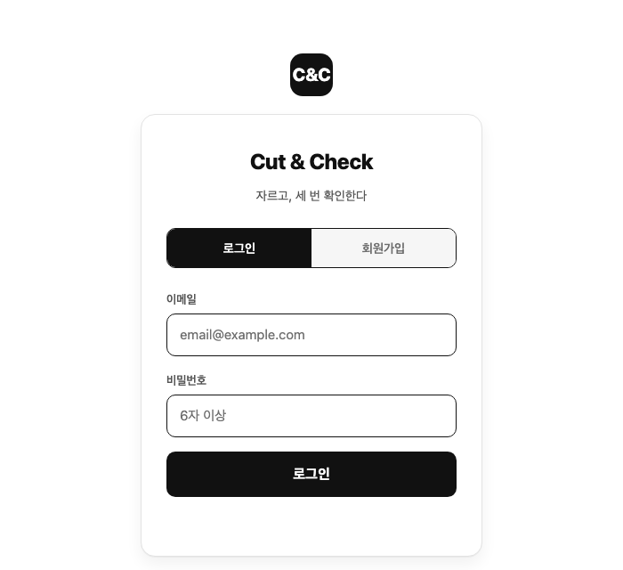 | 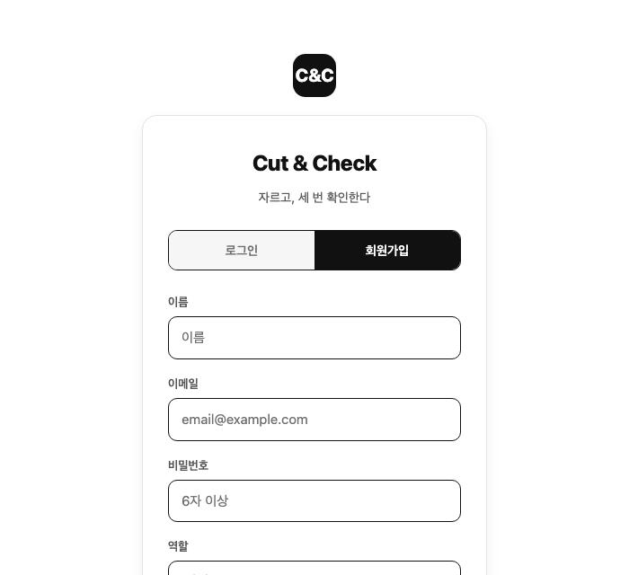 |

- 가입 폼은 이름, 이메일, 비밀번호(6자 이상), **역할(학생 / 강사)** 입니다.
- 역할은 **본인이 드롭다운에서 고릅니다.** 강사 승인이나 초대 절차는 코드에 없습니다. 이메일 인증도 저장소의 로컬 설정 기준으로는 꺼져 있습니다.
- 가입하면 바로 로그인되고, 역할에 따라 아래 화면으로 갑니다.

### 교실 만들기 — 강사

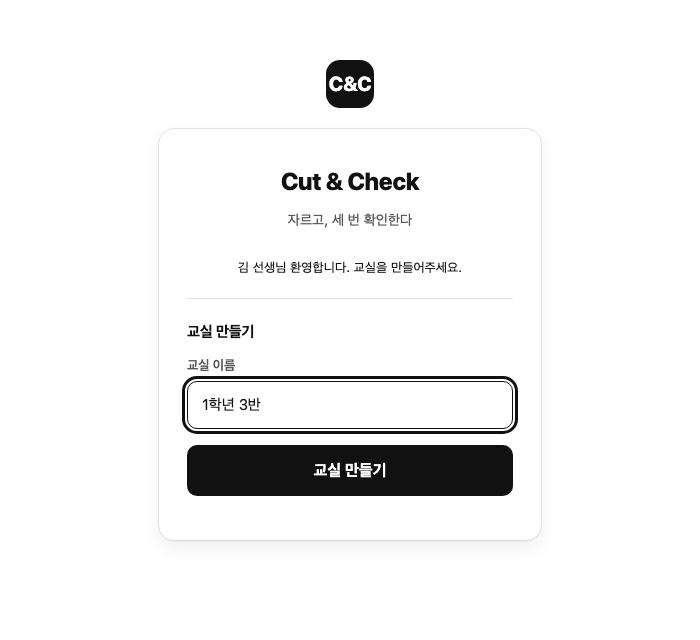

- 교실이 없는 강사가 로그인하면 **교실 이름**을 적는 칸이 나옵니다.
- 만들면 **6자리 참여 코드**가 화면에 크게 나옵니다. 이 코드가 학생이 들어오는 유일한 문입니다.
- 교실은 나중에 선생님 화면(`teacher.html`)의 "내 교실"에서 더 만들 수 있습니다.

### 학생 들어오게 하기

1. 학생이 직접 가입합니다(역할 "학생").
2. 교실이 하나도 없는 학생은 **참여 코드** 칸이 나옵니다. 강사에게 받은 6자리 코드를 넣고 "교실 입장"을 누릅니다.
3. 이미 교실이 있는 학생은 로그인하면 바로 학생 화면(`sentence.html`)으로 갑니다.

강사가 학생을 명단에 직접 추가하는 기능은 없습니다. 코드를 알려 주는 것까지가 강사의 일이고, 잘못 들어온 학생은 선생님 화면에서 **"교실에서 빼기"** 로 내보냅니다.
코드는 선생님 화면의 **학생 추가** 탭에서 다시 볼 수 있습니다.

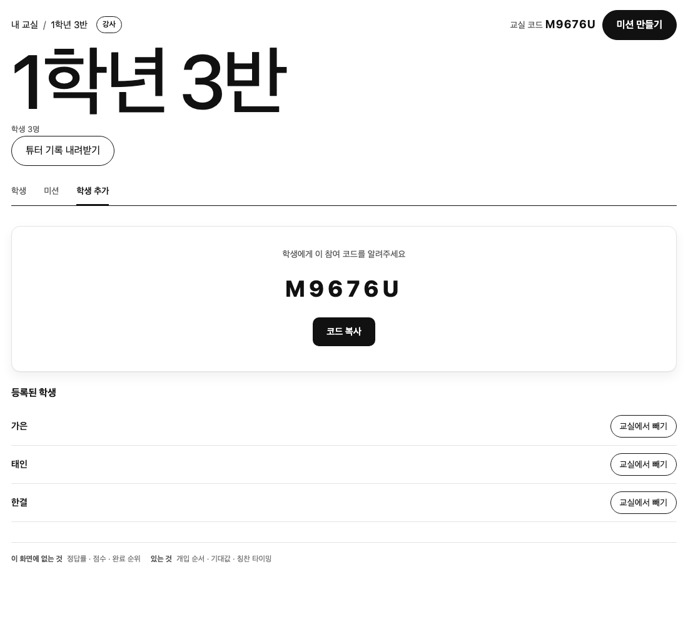

### 미션 올리기 (선택) — `teacher.html` 의 "미션" 탭

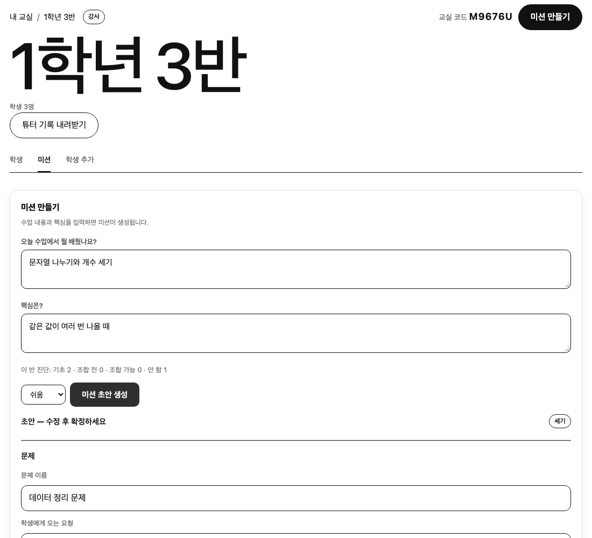

- "오늘 수업에서 뭘 배웠나요?"와 "핵심은?"을 적고 난이도를 고르면 AI가 **미션 초안**을 만듭니다.
- 입력창 아래 한 줄이 **이 반 진단 분포**입니다. 예: `이 반 진단: 기초 1 · 조합 전 1 · 조합 가능 0 · 안 함 1`.
  학생이 첫 입장 때 푼 진단을 **인원수로만** 세어 보여 주고, 같은 숫자를 미션 생성에 함께 넘깁니다. 이름은 나오지 않습니다. 기초가 가장 많으면 난이도가 처음 한 번 "쉬움"으로 맞춰집니다(바꿀 수 있습니다).
- 초안은 문제, 자료, 성공 조건 보기, 설계 카드를 **강사님이 고쳐서 "확정"** 해야 학생에게 보입니다. 검수가 필요한 항목은 초안에 표시됩니다.
- 확정한 미션만 학생의 교실 폴더에 파일로 나타납니다. 교실 모드에서는 코드에 들어 있는 기본 미션이 따로 보이지 않으므로, **미션을 하나도 확정하지 않으면 학생에게는 "아직 올라온 미션이 없어요"가 보입니다.**

---

## 3. 수업 중 (학생) — `sentence.html`

### 교실 입장

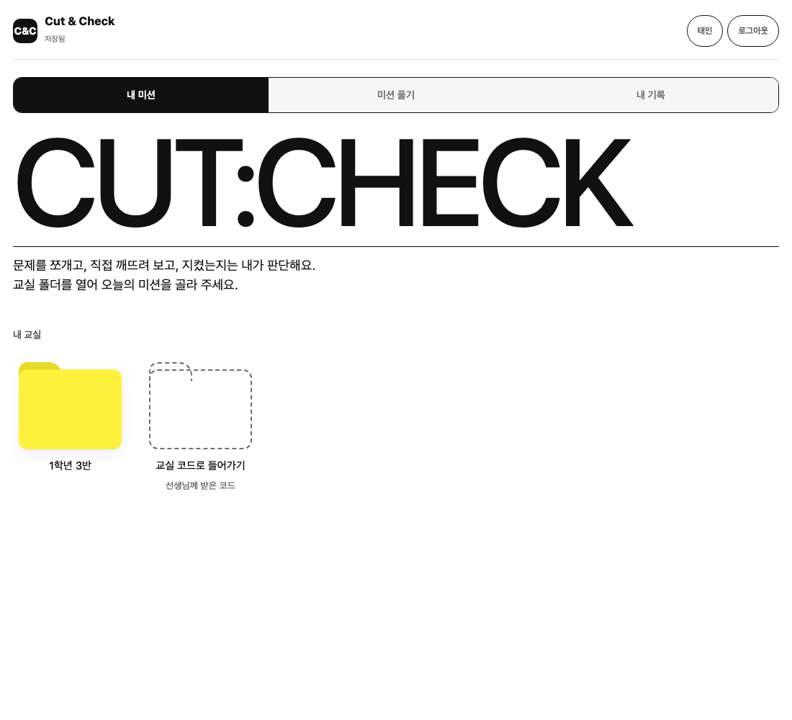

학생은 "내 교실" 폴더를 열고, 안에서 미션 파일을 고릅니다. 다른 학생이 어디까지 갔는지는 학생 화면에 나오지 않습니다.

### 첫 입장 진단 8문항

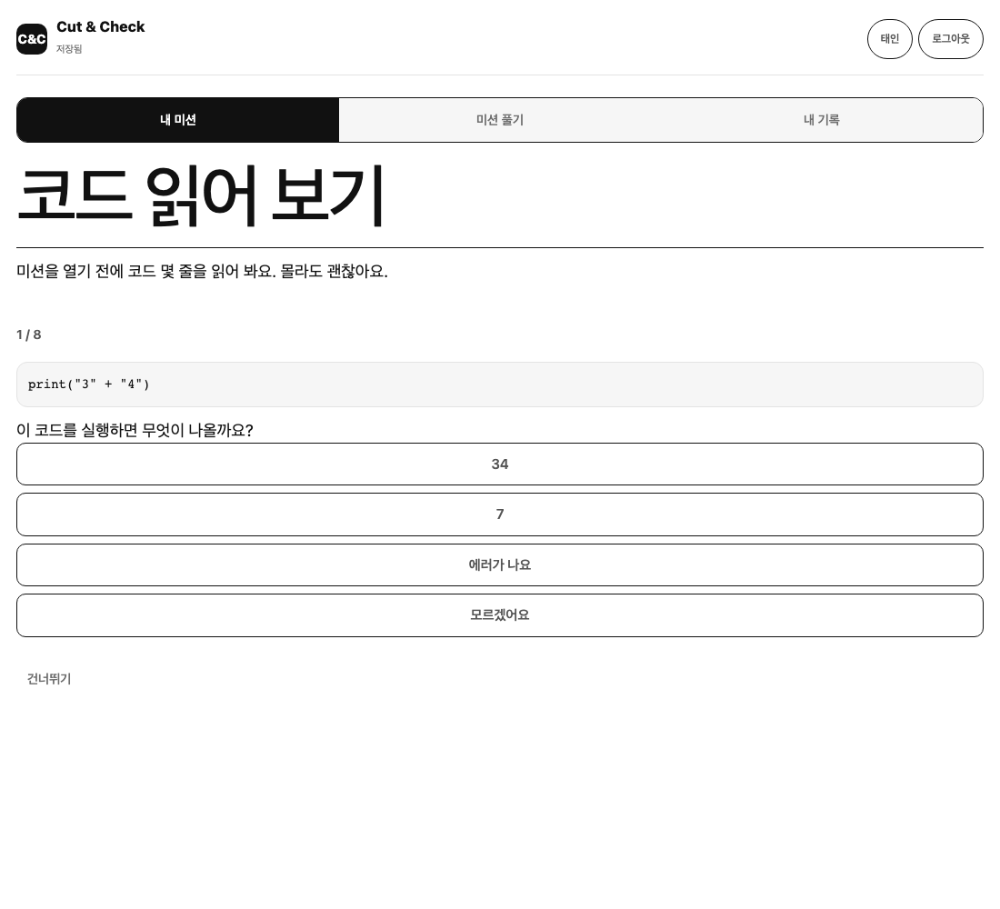

- 교실마다 **처음 한 번**, 코드 몇 줄을 읽고 "무엇이 나올까요?"에 답합니다(8문항, 선택지에 "모르겠어요" 포함).
- **맞았는지 학생에게 알려 주지 않습니다.** 끝나면 "고마워요. 이제 미션을 볼 수 있어요."만 나옵니다.
- **건너뛰기**는 첫 문항에서 누를 수 있습니다. 건너뛴 학생은 반 분포에서 "안 함"으로 셉니다.
- 진단 때문에 수업이 멈추지 않도록, 기록을 확인하지 못하면 진단 없이 미션 목록으로 넘어갑니다.

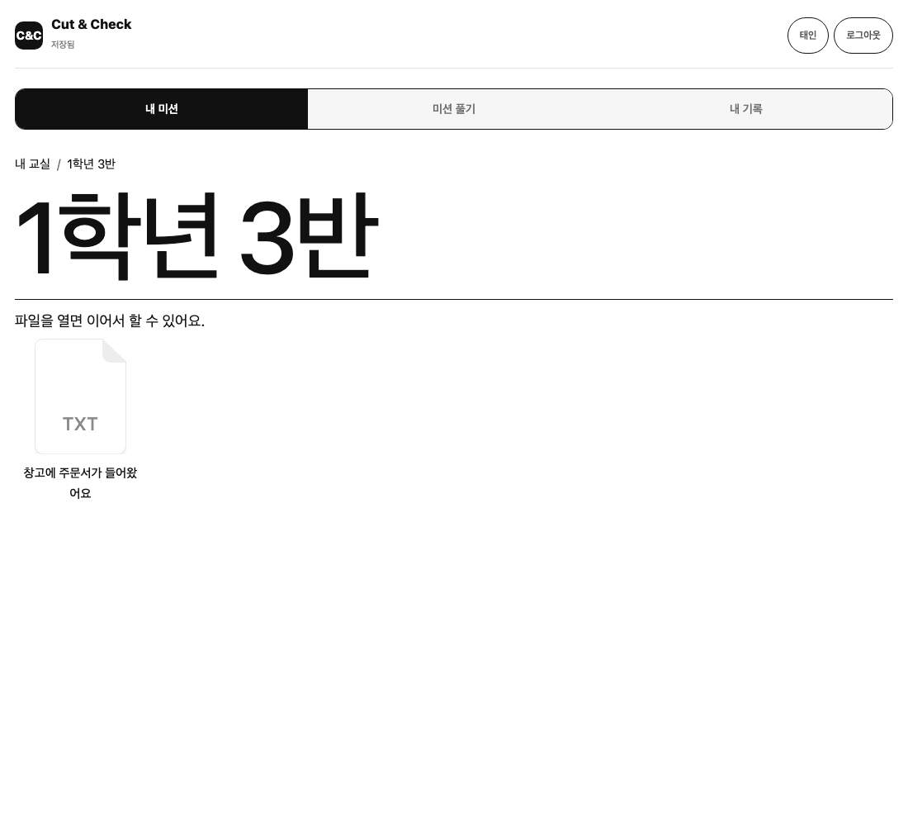

### 미션 단계 01~05

미션 위쪽의 `01 문제 · 02 성공 · 03 설계 · 04 코딩 · 05 정리` 탭으로 지나온 단계로 돌아갈 수 있습니다. 고친 기록은 지워지지 않고 남습니다.

**01 문제** — 업무 요청 한 문장과 예시 자료 2개를 읽습니다.
- 학생이 하는 일: 무엇을 해 달라는 요청인지 읽습니다.
- 화면이 하지 않는 일: 풀이 방법을 알려 주지 않습니다. 요청은 일부러 모호하게 쓰여 있습니다.

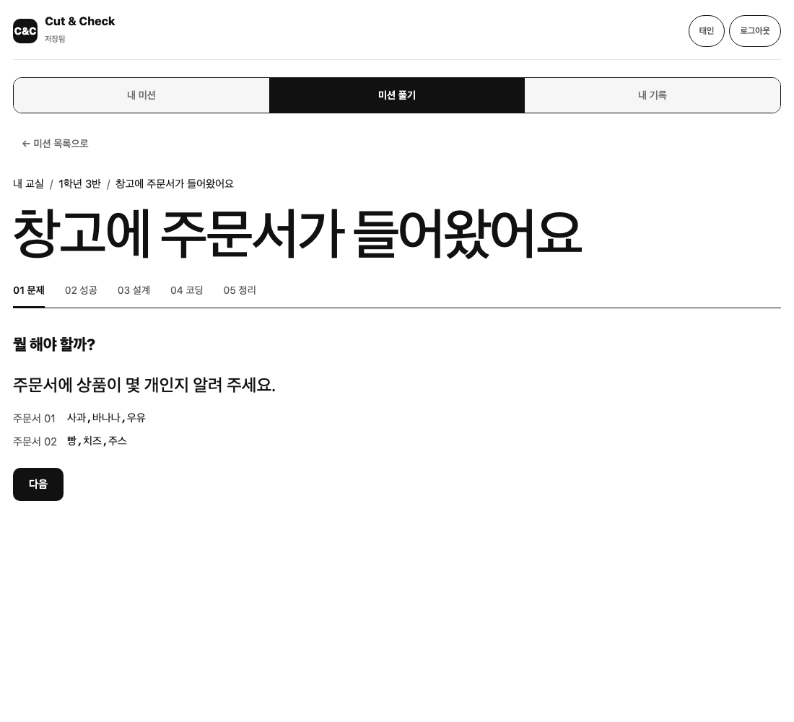

**02 성공** — "어떤 결과가 나오면 성공일까요?"에 보기 중 하나를 고르고 이유를 적습니다.
- 학생이 하는 일: 성공의 뜻을 스스로 정합니다.
- 화면이 하지 않는 일: 어느 보기가 맞는지 말하지 않습니다. 보기에는 "이번 결과만 맞추면 되는 문장" 같은 함정이 섞여 있을 수 있습니다.

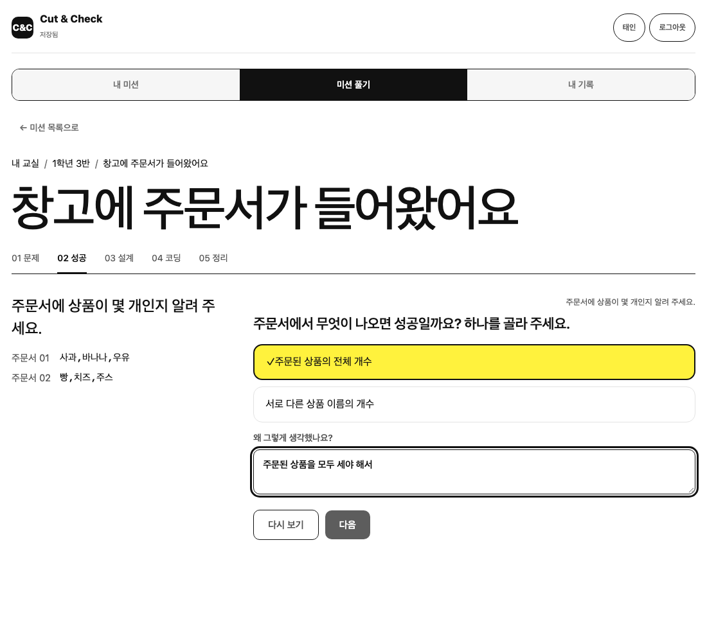

**03 설계** — 할 일 카드를 눌러 담고 ▲▼로 순서를 맞춘 뒤 이유를 적습니다. 카드에서 "나누기" 기준 같은 세부는 고릅니다.
- 학생이 하는 일: 어떤 일을, 어떤 순서로 할지 설계도를 만듭니다.
- 화면이 하지 않는 일: 순서를 채점하거나 다음 카드를 추천하지 않습니다. 필요 없는 카드도 섞여 있습니다.

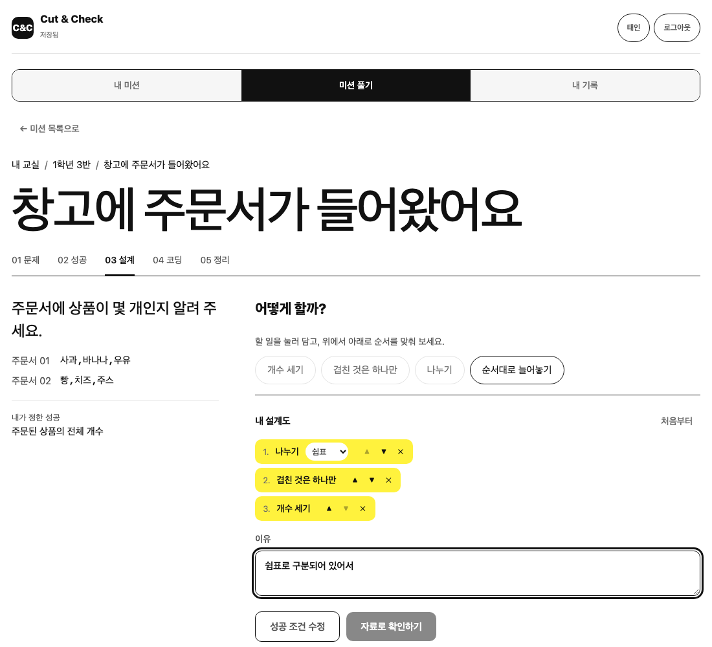

**04 코딩** — 왼쪽에 설계도를 두고 파이썬 코드를 **직접 씁니다.** "자료 3개로 실행"을 누르면 같은 코드가 자료마다 돌고 결과가 표로 나란히 나옵니다. 마지막 자료는 "새로 온 자료"로, 처음 두 자료와 다르게 생긴 경우를 만나게 하려는 것입니다.
- 학생이 하는 일: 코드를 쓰고 실행하고, 결과를 보고 "지켰다 / 지키지 못했다 / 아직 모르겠다" 중 하나를 고른 뒤 근거를 적습니다.
- 화면이 하지 않는 일: 정답 코드와 비교하지 않고, 힌트를 미리 열어 주지 않습니다. 에러는 몇 번째 줄인지와 사실만 말합니다. 무한 반복은 5초 뒤 멈춥니다.
- 설계 수정으로 되돌아갈 수 있고, 쓴 코드는 설계를 고쳐도 남습니다.

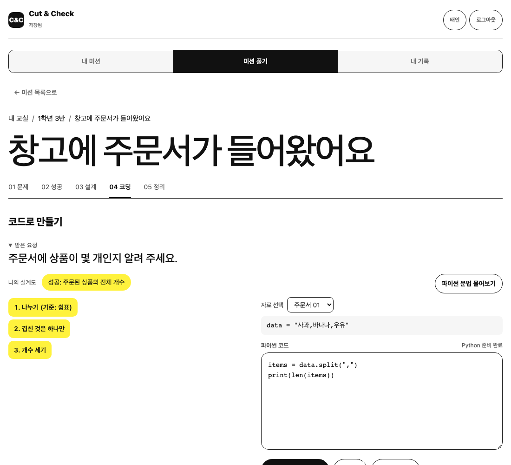

**05 정리** — 지금까지 한 것(성공 조건, 설계도, 자료별 결과, 내 판정과 근거)이 모아 보이고, "처음 생각과 달랐던 점이 있나요?"에 한두 문장을 적어 저장합니다.
- 학생이 하는 일: 오늘의 판단을 자기 말로 돌아봅니다.
- 화면이 하지 않는 일: 잘했다는 문구를 띄우지 않습니다. 이 문장은 **강사님이 읽습니다.**

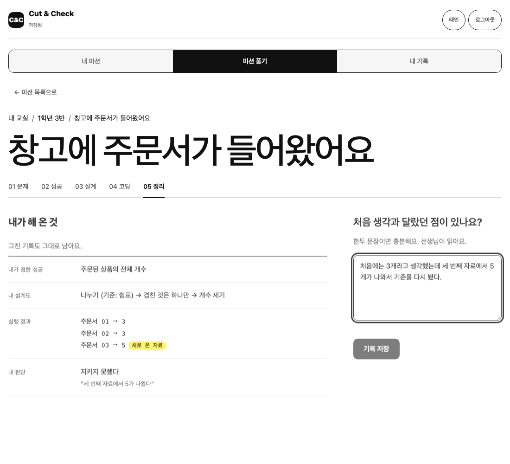

### 튜터 (04 단계에서만)

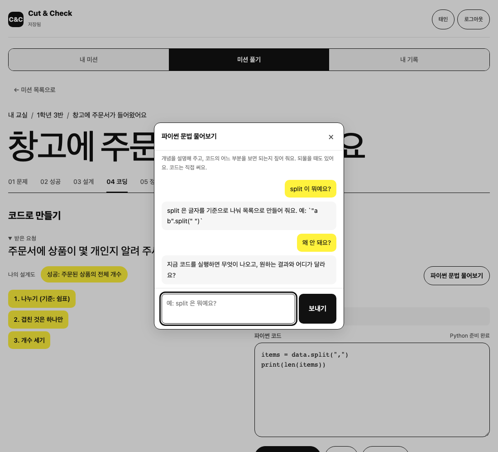

- 설계도를 낸 뒤 **04 코딩 단계에서만** "파이썬 문법 물어보기" 버튼이 보입니다.
- 답해 주는 것: 문법 개념 설명, 학생 코드에서 문제가 있는 **위치**, 이 미션과 다른 자료로 든 짧은 사용 예시.
- 답하지 않는 것: 이 미션의 풀이 방법, 풀이 순서, 이 자료로 동작하는 코드. 파이썬과 상관없는 질문은 받지 않습니다.
- 답하기 어려우면 거절하는 대신 **되묻습니다.** 예: "지금 코드를 실행하면 무엇이 나오고, 원하는 결과와 어디가 달라요?"
- 질문(300자까지)과 답은 **그대로 기록되어 강사 화면에 올라갑니다.**

### 마무리

"기록 저장"을 누르면 끝납니다. 학생은 "내 기록" 탭에서 지금까지 한 것을 다시 볼 수 있습니다.

### 다른 화면(index / abstract / review / make)은?

- `index.html` 은 지금 소개 페이지(`landing.html`)로 넘기는 파일입니다. 소개 페이지의 "시작하기"는 `auth.html` 로 갑니다.
- `abstract.html`(미션 04 추상화), `review.html`(미션 05 동료 검토), `make.html`(내 미션 만들기)은 서로 링크로 이어진 **별도 화면**입니다. 로그인 → 교실 → 학생 화면/선생님 화면 흐름에서는 이 화면들로 가는 링크를 찾지 못했습니다. 수업에 쓰실지는 코드만으로는 알 수 없어 이 안내에서는 다루지 않았습니다.

---

## 4. 수업 중 (강사) — `teacher.html`

### 교실을 열면

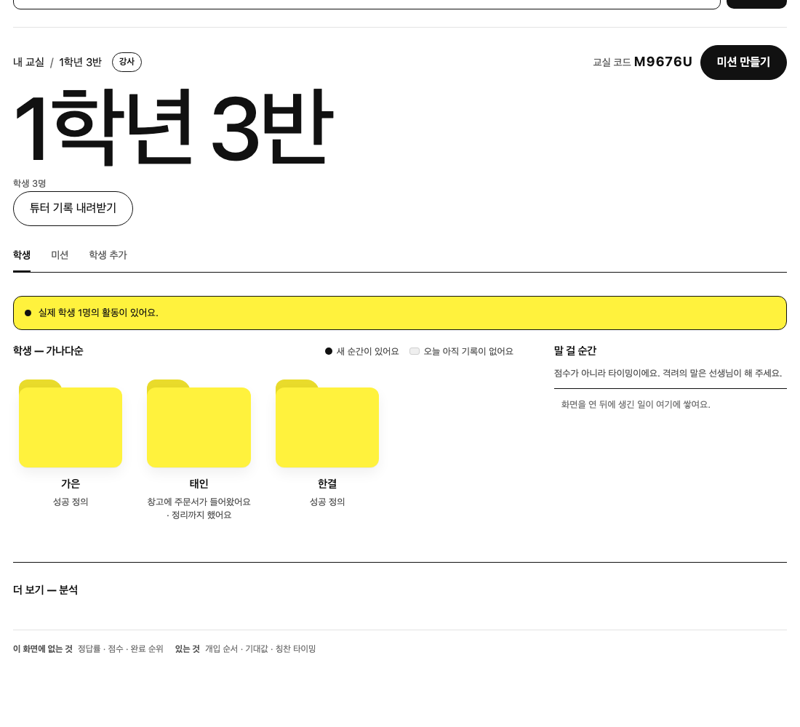

- 학생은 **가나다순 폴더**로 보입니다. 진도순이 아닙니다. 폴더 아래에는 "미션 이름 · 지금 단계" 한 줄이 있습니다. 기록이 없는 학생도 폴더로 보입니다(회색).
- 화면을 연 뒤 새 활동이 생긴 학생의 폴더에는 점이 찍히고, 오른쪽 **"말 걸 순간"** 에 "설계도를 냈어요" 같은 **사실만** 쌓입니다. 5초마다 갱신됩니다.
- 접혀 있는 "더 보기 — 분석"에 집계 패널이 있고, 화면 맨 아래에는 "이 화면에 없는 것: 정답률 · 점수 · 완료 순위"라고 적혀 있습니다.

### 학생 폴더(서랍)를 열면

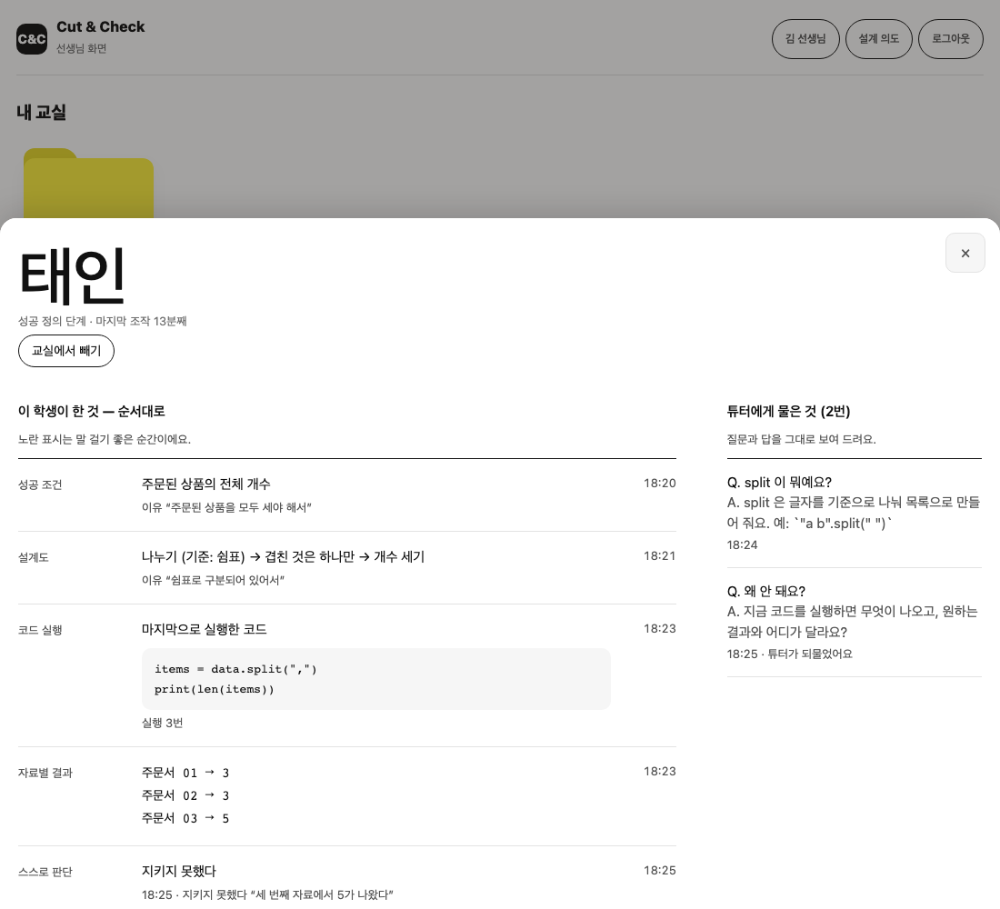

- 왼쪽: 이 학생이 한 것을 **시간 순서대로** 보여 줍니다. 성공 조건과 이유, 설계도, 마지막으로 실행한 코드와 실행 횟수, 자료별 결과, 스스로 판단한 내용과 근거, 마무리 문장.
- 학생이 결과를 보고 자기 기준을 고친 순간은 노란 표시("말 걸기 좋은 순간")로 남습니다. 무슨 말을 할지는 적혀 있지 않습니다.
- 오른쪽: **튜터에게 물은 것**. 질문과 답이 그대로 보이고, 튜터가 되물었거나 답하지 않은 경우에는 그렇게 표시됩니다.
- "이 학생에게 먼저 물어볼 것"에는 강사님이 건넬 **질문 하나**만 제안됩니다. 칭찬 문구나 평가는 쓰여 있지 않습니다.

### 튜터 기록 내려받기

교실 이름 아래의 **"튜터 기록 내려받기"** 버튼이 CSV 파일(`tutor-교실이름-날짜.csv`)을 만듭니다. 5절을 보세요.

### 의도적으로 보여 주지 않는 것

| 보여 주지 않는 것 | 이유 |
|---|---|
| 점수, 정답률, 완료 순위, 소요 시간 순위 | 숫자를 띄우면 줄 세우기가 시작되고, 학생은 다시 결과를 맞히러 가게 됩니다. |
| 학생 개인의 진단 결과 | 진단은 인원수 분포로만 쓰입니다(미션 탭의 한 줄). 학생 폴더나 서랍에는 개인 진단 결과가 없습니다. |
| 학생 화면의 다른 학생 현황 | 옆자리가 어디까지 갔는지 보이면 수업이 속도 경쟁이 됩니다. |

---

## 5. 수업 후

- **튜터 기록 CSV**: 열은 `시각, 학생, 미션, 단계, 분류, 거절, 질문, 답, 막힌 이유, 다시 요청` 입니다. 학생 이름과 학생이 쓴 글이 그대로 들어 있습니다. 엑셀에서 열면 한글이 깨지지 않도록 만들어져 있고, 점수·정답률·순위 열은 없습니다.
- 용도는 **수업 개선**입니다. 학생들이 어디서 막혀 무엇을 물었는지, 튜터가 몇 번 되물었는지를 다음 수업의 미션과 설명에 반영하기 위한 자료입니다. 학생을 평가하는 자료로 쓰도록 만들어진 것이 아닙니다.
- 학생의 설계, 코드, 판단, 마무리 문장은 수업이 끝난 뒤에도 선생님 화면의 학생 서랍에서 그대로 다시 읽을 수 있습니다. 별도의 성적 리포트는 없습니다.

---

## 6. 한 장 요약

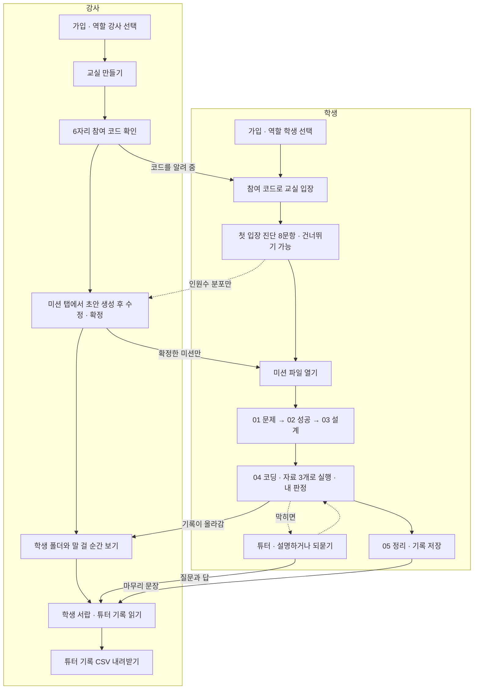

---

## 7. 자주 묻는 것

**Q. 학교 와이파이가 끊기면요?**
A. 화면은 학생 브라우저에 이미 떠 있으므로 계속 쓸 수 있고, 학생이 한 기록은 그 브라우저에 먼저 저장됩니다. 다만 **교실로 올라가는 기록은 한 번만 보내고 다시 보내지 않는 것으로 코드에 되어 있어서**, 끊긴 동안의 기록은 강사 화면에 안 올라올 수 있습니다. 튜터는 서버가 있어야 하며, 안 되면 "지금은 튜터를 쓸 수 없어요."만 나오고 수업은 계속됩니다. 처음 접속할 때와 파이썬 실행기를 처음 내려받을 때는 인터넷이 필요합니다.

**Q. 학생이 진단을 건너뛰면요?**
A. 막지 않습니다. 그 학생은 반 분포에서 "안 함"으로만 세어지고, 미션은 똑같이 열립니다. 개인 진단 결과는 학생에게도 강사에게도 보이지 않습니다.

**Q. 튜터가 답을 안 주고 되묻기만 해요.**
A. 의도한 동작입니다. 풀이 방법과 동작하는 코드는 튜터가 말하지 않도록 되어 있어서, 학생이 막힌 곳을 말해야 설명이 시작됩니다. 학생 서랍 오른쪽에서 "튜터가 되물었어요" 표시와 질문을 보고 강사님이 직접 이어 주시면 됩니다.

**Q. 학생이 04 단계의 결과를 "지키지 못했다"로 골랐어요. 틀린 건가요?**
A. 화면은 맞고 틀림을 정하지 않습니다. 근거 글과 함께 서랍에 남기 때문에, 그 근거를 보고 질문으로 이어 가시면 됩니다.

**Q. 학생이 교실에 잘못 들어왔어요.**
A. 선생님 화면의 학생 폴더 서랍이나 "학생 추가" 탭의 명단에서 **"교실에서 빼기"** 를 누르면 명단과 기록이 화면에서 빠집니다. 코드는 바꿀 수 없으므로 이미 알려 준 코드는 계속 유효합니다.
